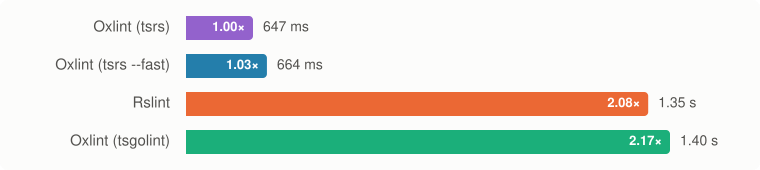
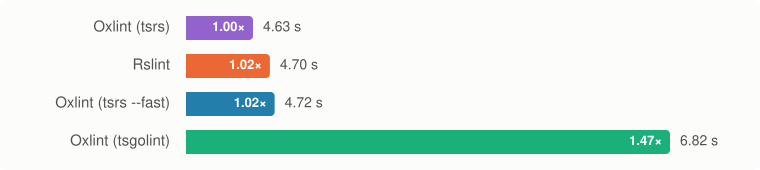
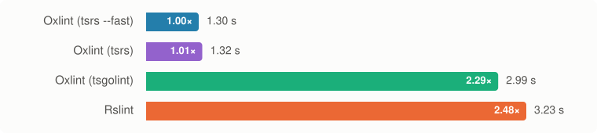
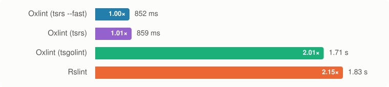
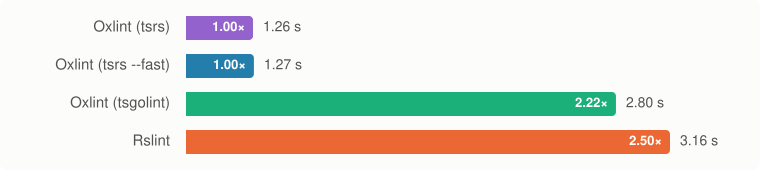
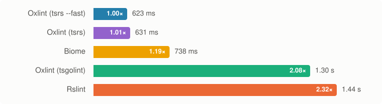
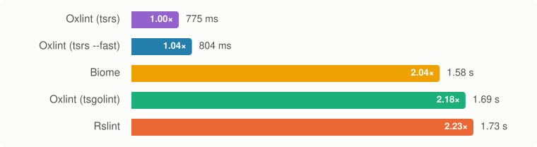
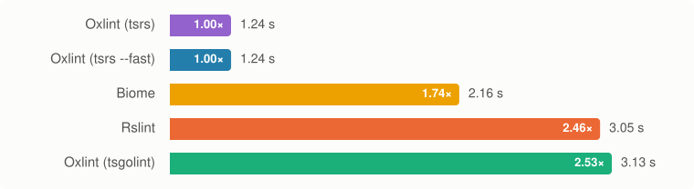
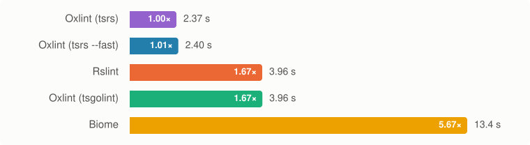
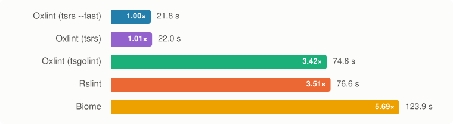

# Type-Aware Linter Benchmark

Rslint, Oxlint and Biome on seven Rstack monorepos, VS Code and TypeScript.

[Archived benchmark results](archives/README.md)

## Experiments

| Group | Tools | Rules |
|---|---|---|
| **A** | Rslint, Oxlint (tsgolint), Oxlint (tsrs), Oxlint (tsrs --fast) | 68 syntactic + 23 type-aware |
| **B** | Group A + Biome | 57 syntactic + 9 type-aware |
| **C** | Rslint, Oxlint, Biome | 56 syntactic, no type information |

Each group enables the shared rules from the pinned baseline. The type-aware Oxlint variants use one configuration, with different engines or presets. Oxlint (tsrs) sets `TSRS_FAST=0`; Oxlint (tsrs --fast) sets `TSRS_FAST=1`.

<!-- results:start -->
<!-- Generated by scripts/06-report.mjs. Do not edit by hand. -->

## Results

| Group | Fastest tool (fixtures won) |
|---|---|
| A | **Oxlint (tsrs)** 5/9 · **Oxlint (tsrs --fast)** 4/9 |
| B | **Oxlint (tsrs)** 5/9 · **Oxlint (tsrs --fast)** 4/9 |
| C | **Oxlint** 9/9 |

Runner: Linux 7.0.0-1017-azure (x64), AMD EPYC 7763 64-Core Processor, 4 CPUs, 16 GiB RAM. Node v26.5.1, pnpm 12.18.0. [Workflow run](https://github.com/elecmonkey/linter-benchmark/actions/runs/43815439378).

The Oxlint variants use the same file scope and rule configuration. tsrs default mode uses `TSRS_FAST=0`; fast mode uses `TSRS_FAST=1`. Diagnostic counts can differ between engines and are reported separately.

### Group A: Rslint, Oxlint (tsgolint), Oxlint (tsrs), Oxlint (tsrs --fast)

68 syntactic + 23 type-aware rules. Median of 5 runs after 1 warmup. Bar lengths are log-scaled; the labels give exact values.

#### [rstack-cli](https://github.com/rstackjs/rstack-cli/tree/b35a79a98d4cdb84fc9c56f7b5fb5625cb74c1c9)

**Files:** 366


| Tool | Median | Min | Max | Peak RSS | Diagnostics | Relative |
|---|--:|--:|--:|--:|--:|--:|
| Oxlint (tsrs --fast) | 622 ms | 612 ms | 628 ms | 245 MB | 259 | 1.00× |
| Oxlint (tsrs) | 633 ms | 612 ms | 636 ms | 241 MB | 259 | 1.02× |
| Oxlint (tsgolint) | 1.35 s | 1.26 s | 1.37 s | 489 MB | 259 | 2.16× |
| Rslint | 1.45 s | 1.38 s | 1.51 s | 340 MB | 468 | 2.33× |

#### [rspack](https://github.com/web-infra-dev/rspack/tree/6c1f72b0991a7c691c8e951d6a7821b3d532f6d5)

**Files:** 493



| Tool | Median | Min | Max | Peak RSS | Diagnostics | Relative |
|---|--:|--:|--:|--:|--:|--:|
| Oxlint (tsrs) | 818 ms | 782 ms | 825 ms | 321 MB | 3,178 | 1.00× |
| Oxlint (tsrs --fast) | 836 ms | 822 ms | 857 ms | 316 MB | 3,178 | 1.02× |
| Rslint | 1.73 s | 1.69 s | 1.85 s | 450 MB | 3,214 | 2.12× |
| Oxlint (tsgolint) | 1.83 s | 1.71 s | 1.89 s | 627 MB | 3,178 | 2.24× |

#### [rsdoctor](https://github.com/web-infra-dev/rsdoctor/tree/80b2381d1a20901e1f12b3f2bb2778aaacf94f2f)

**Files:** 734


| Tool | Median | Min | Max | Peak RSS | Diagnostics | Relative |
|---|--:|--:|--:|--:|--:|--:|
| Oxlint (tsrs --fast) | 1.32 s | 1.30 s | 1.38 s | 405 MB | 3,735 | 1.00× |
| Oxlint (tsrs) | 1.35 s | 1.33 s | 1.35 s | 404 MB | 3,735 | 1.02× |
| Rslint | 3.35 s | 3.35 s | 3.48 s | 669 MB | 3,708 | 2.53× |
| Oxlint (tsgolint) | 3.37 s | 3.32 s | 3.41 s | 926 MB | 3,735 | 2.54× |

#### [typescript6](https://github.com/microsoft/TypeScript/tree/050880ce59e30b356b686bd3144efe24f875ebc8)

**Files:** 745



| Tool | Median | Min | Max | Peak RSS | Diagnostics | Relative |
|---|--:|--:|--:|--:|--:|--:|
| Oxlint (tsrs) | 6.00 s | 5.90 s | 6.05 s | 549 MB | 11,416 | 1.00× |
| Oxlint (tsrs --fast) | 6.03 s | 5.91 s | 6.12 s | 561 MB | 11,416 | 1.00× |
| Rslint | 6.71 s | 6.54 s | 6.76 s | 716 MB | 11,724 | 1.12× |
| Oxlint (tsgolint) | 9.20 s | 8.99 s | 9.56 s | 1,244 MB | 11,416 | 1.53× |

#### [rspress](https://github.com/web-infra-dev/rspress/tree/6f87abf1d323ced2883261642561a3fc88fbd278)

**Files:** 746



| Tool | Median | Min | Max | Peak RSS | Diagnostics | Relative |
|---|--:|--:|--:|--:|--:|--:|
| Oxlint (tsrs --fast) | 1.30 s | 1.28 s | 1.31 s | 351 MB | 2,741 | 1.00× |
| Oxlint (tsrs) | 1.32 s | 1.30 s | 1.33 s | 355 MB | 2,741 | 1.01× |
| Oxlint (tsgolint) | 2.99 s | 2.88 s | 3.07 s | 779 MB | 2,741 | 2.29× |
| Rslint | 3.23 s | 3.20 s | 3.24 s | 583 MB | 2,875 | 2.48× |

#### [rslib](https://github.com/web-infra-dev/rslib/tree/0734e3624dd7bfb08fdfc4ff0416404a9a551df4)

**Files:** 1,018



| Tool | Median | Min | Max | Peak RSS | Diagnostics | Relative |
|---|--:|--:|--:|--:|--:|--:|
| Oxlint (tsrs) | 1.04 s | 1.03 s | 1.10 s | 351 MB | 674 | 1.00× |
| Oxlint (tsrs --fast) | 1.06 s | 1.02 s | 1.09 s | 360 MB | 674 | 1.01× |
| Oxlint (tsgolint) | 2.20 s | 2.16 s | 2.35 s | 719 MB | 675 | 2.11× |
| Rslint | 2.41 s | 2.32 s | 2.48 s | 530 MB | 661 | 2.31× |

#### [rstest](https://github.com/web-infra-dev/rstest/tree/03cabf3dd586392a6bfa4720e5a92c37281b943a)

**Files:** 2,139



| Tool | Median | Min | Max | Peak RSS | Diagnostics | Relative |
|---|--:|--:|--:|--:|--:|--:|
| Oxlint (tsrs) | 1.60 s | 1.58 s | 1.65 s | 412 MB | 35,913 | 1.00× |
| Oxlint (tsrs --fast) | 1.63 s | 1.59 s | 1.75 s | 420 MB | 35,913 | 1.02× |
| Oxlint (tsgolint) | 3.80 s | 3.67 s | 3.91 s | 916 MB | 35,913 | 2.38× |
| Rslint | 4.37 s | 4.24 s | 4.47 s | 546 MB | 36,572 | 2.74× |

#### [rsbuild](https://github.com/web-infra-dev/rsbuild/tree/622f5df2b43c12423b50ed986e0f0983c338bf91)

**Files:** 2,450


| Tool | Median | Min | Max | Peak RSS | Diagnostics | Relative |
|---|--:|--:|--:|--:|--:|--:|
| Oxlint (tsrs) | 1.53 s | 1.52 s | 1.59 s | 338 MB | 985 | 1.00× |
| Oxlint (tsrs --fast) | 1.53 s | 1.52 s | 1.59 s | 337 MB | 985 | 1.00× |
| Oxlint (tsgolint) | 3.18 s | 3.12 s | 3.23 s | 782 MB | 985 | 2.08× |
| Rslint | 4.02 s | 3.91 s | 4.12 s | 586 MB | 1,013 | 2.63× |

#### [vscode](https://github.com/microsoft/vscode/tree/f92b8f3adcd9bc034e6b9ade05c093dd59b99c5f)

**Files:** 14,258


| Tool | Median | Min | Max | Peak RSS | Diagnostics | Relative |
|---|--:|--:|--:|--:|--:|--:|
| Oxlint (tsrs --fast) | 28.4 s | 28.0 s | 28.6 s | 4,052 MB | 163,616 | 1.00× |
| Oxlint (tsrs) | 29.0 s | 28.1 s | 29.6 s | 4,577 MB | 163,616 | 1.02× |
| Oxlint (tsgolint) | 97.3 s | 94.9 s | 102.7 s | 14,493 MB | 163,615 | 3.43× |
| Rslint | 97.6 s | 94.9 s | 100.8 s | 13,969 MB | 167,372 | 3.44× |

### Group B: Rslint, Oxlint (tsgolint), Oxlint (tsrs), Oxlint (tsrs --fast), Biome

57 syntactic + 9 type-aware rules. Median of 5 runs after 1 warmup. Bar lengths are log-scaled; the labels give exact values.

#### [rstack-cli](https://github.com/rstackjs/rstack-cli/tree/b35a79a98d4cdb84fc9c56f7b5fb5625cb74c1c9)

**Files:** 366



| Tool | Median | Min | Max | Peak RSS | Diagnostics | Relative |
|---|--:|--:|--:|--:|--:|--:|
| Oxlint (tsrs --fast) | 623 ms | 616 ms | 638 ms | 242 MB | 36 | 1.00× |
| Oxlint (tsrs) | 631 ms | 623 ms | 635 ms | 242 MB | 36 | 1.01× |
| Biome | 738 ms | 720 ms | 744 ms | 283 MB | 22 | 1.19× |
| Oxlint (tsgolint) | 1.30 s | 1.27 s | 1.34 s | 453 MB | 36 | 2.08× |
| Rslint | 1.44 s | 1.35 s | 1.50 s | 337 MB | 25 | 2.32× |

#### [rspack](https://github.com/web-infra-dev/rspack/tree/6c1f72b0991a7c691c8e951d6a7821b3d532f6d5)

**Files:** 493



| Tool | Median | Min | Max | Peak RSS | Diagnostics | Relative |
|---|--:|--:|--:|--:|--:|--:|
| Oxlint (tsrs) | 775 ms | 755 ms | 795 ms | 304 MB | 998 | 1.00× |
| Oxlint (tsrs --fast) | 804 ms | 781 ms | 818 ms | 305 MB | 998 | 1.04× |
| Biome | 1.58 s | 1.57 s | 1.59 s | 495 MB | 937 | 2.04× |
| Oxlint (tsgolint) | 1.69 s | 1.65 s | 1.79 s | 588 MB | 998 | 2.18× |
| Rslint | 1.73 s | 1.71 s | 1.74 s | 440 MB | 1,021 | 2.23× |

#### [rsdoctor](https://github.com/web-infra-dev/rsdoctor/tree/80b2381d1a20901e1f12b3f2bb2778aaacf94f2f)

**Files:** 734



| Tool | Median | Min | Max | Peak RSS | Diagnostics | Relative |
|---|--:|--:|--:|--:|--:|--:|
| Oxlint (tsrs) | 1.24 s | 1.20 s | 1.26 s | 398 MB | 613 | 1.00× |
| Oxlint (tsrs --fast) | 1.24 s | 1.21 s | 1.27 s | 389 MB | 613 | 1.00× |
| Biome | 2.16 s | 2.11 s | 2.24 s | 669 MB | 549 | 1.74× |
| Rslint | 3.05 s | 3.02 s | 3.14 s | 639 MB | 625 | 2.46× |
| Oxlint (tsgolint) | 3.13 s | 3.01 s | 3.19 s | 892 MB | 613 | 2.53× |

#### [typescript6](https://github.com/microsoft/TypeScript/tree/050880ce59e30b356b686bd3144efe24f875ebc8)

**Files:** 745



| Tool | Median | Min | Max | Peak RSS | Diagnostics | Relative |
|---|--:|--:|--:|--:|--:|--:|
| Oxlint (tsrs) | 2.97 s | 2.91 s | 3.00 s | 551 MB | 1,885 | 1.00× |
| Oxlint (tsrs --fast) | 3.01 s | 2.96 s | 3.03 s | 541 MB | 1,885 | 1.01× |
| Rslint | 5.37 s | 5.22 s | 5.50 s | 744 MB | 2,213 | 1.81× |
| Oxlint (tsgolint) | 5.38 s | 5.30 s | 5.41 s | 1,129 MB | 1,885 | 1.81× |
| Biome | 16.1 s | 16.0 s | 16.8 s | 2,350 MB | 2,328 | 5.44× |

#### [rspress](https://github.com/web-infra-dev/rspress/tree/6f87abf1d323ced2883261642561a3fc88fbd278)

**Files:** 746


| Tool | Median | Min | Max | Peak RSS | Diagnostics | Relative |
|---|--:|--:|--:|--:|--:|--:|
| Oxlint (tsrs --fast) | 1.30 s | 1.28 s | 1.33 s | 341 MB | 187 | 1.00× |
| Oxlint (tsrs) | 1.31 s | 1.29 s | 1.31 s | 346 MB | 187 | 1.01× |
| Biome | 1.71 s | 1.67 s | 1.73 s | 560 MB | 179 | 1.32× |
| Oxlint (tsgolint) | 2.86 s | 2.78 s | 2.97 s | 764 MB | 187 | 2.20× |
| Rslint | 3.24 s | 3.13 s | 3.35 s | 527 MB | 190 | 2.50× |

#### [rslib](https://github.com/web-infra-dev/rslib/tree/0734e3624dd7bfb08fdfc4ff0416404a9a551df4)

**Files:** 1,018


| Tool | Median | Min | Max | Peak RSS | Diagnostics | Relative |
|---|--:|--:|--:|--:|--:|--:|
| Oxlint (tsrs) | 1.05 s | 1.05 s | 1.07 s | 335 MB | 207 | 1.00× |
| Oxlint (tsrs --fast) | 1.06 s | 1.06 s | 1.09 s | 338 MB | 207 | 1.01× |
| Biome | 1.81 s | 1.80 s | 1.83 s | 577 MB | 203 | 1.72× |
| Oxlint (tsgolint) | 2.25 s | 2.22 s | 2.28 s | 706 MB | 208 | 2.13× |
| Rslint | 2.42 s | 2.35 s | 2.49 s | 444 MB | 186 | 2.29× |

#### [rstest](https://github.com/web-infra-dev/rstest/tree/03cabf3dd586392a6bfa4720e5a92c37281b943a)

**Files:** 2,139


| Tool | Median | Min | Max | Peak RSS | Diagnostics | Relative |
|---|--:|--:|--:|--:|--:|--:|
| Oxlint (tsrs --fast) | 1.39 s | 1.36 s | 1.42 s | 356 MB | 1,521 | 1.00× |
| Oxlint (tsrs) | 1.40 s | 1.38 s | 1.41 s | 366 MB | 1,521 | 1.01× |
| Biome | 3.11 s | 3.04 s | 3.15 s | 746 MB | 1,576 | 2.24× |
| Oxlint (tsgolint) | 3.45 s | 3.35 s | 3.46 s | 829 MB | 1,521 | 2.49× |
| Rslint | 3.84 s | 3.66 s | 4.52 s | 547 MB | 1,578 | 2.77× |

#### [rsbuild](https://github.com/web-infra-dev/rsbuild/tree/622f5df2b43c12423b50ed986e0f0983c338bf91)

**Files:** 2,450


| Tool | Median | Min | Max | Peak RSS | Diagnostics | Relative |
|---|--:|--:|--:|--:|--:|--:|
| Oxlint (tsrs) | 1.56 s | 1.53 s | 1.58 s | 333 MB | 95 | 1.00× |
| Oxlint (tsrs --fast) | 1.58 s | 1.55 s | 1.59 s | 325 MB | 95 | 1.01× |
| Biome | 1.68 s | 1.66 s | 1.73 s | 282 MB | 153 | 1.07× |
| Oxlint (tsgolint) | 3.19 s | 3.12 s | 3.26 s | 741 MB | 95 | 2.05× |
| Rslint | 4.09 s | 3.92 s | 4.17 s | 548 MB | 82 | 2.62× |

#### [vscode](https://github.com/microsoft/vscode/tree/f92b8f3adcd9bc034e6b9ade05c093dd59b99c5f)

**Files:** 14,258



| Tool | Median | Min | Max | Peak RSS | Diagnostics | Relative |
|---|--:|--:|--:|--:|--:|--:|
| Oxlint (tsrs --fast) | 21.8 s | 21.7 s | 22.4 s | 3,708 MB | 50,346 | 1.00× |
| Oxlint (tsrs) | 22.0 s | 21.8 s | 22.3 s | 4,255 MB | 50,346 | 1.01× |
| Oxlint (tsgolint) | 74.6 s | 69.5 s | 76.9 s | 14,064 MB | 50,346 | 3.42× |
| Rslint | 76.6 s | 74.4 s | 77.5 s | 12,088 MB | 55,064 | 3.51× |
| Biome | 123.9 s | 120.1 s | 126.3 s | 14,288 MB | 43,975 | 5.69× |

### Group C: Rslint, Oxlint, Biome

56 syntactic rules, no type information. Median of 5 runs after 1 warmup. Bar lengths are log-scaled; the labels give exact values.

#### [rstack-cli](https://github.com/rstackjs/rstack-cli/tree/b35a79a98d4cdb84fc9c56f7b5fb5625cb74c1c9)

**Files:** 366


| Tool | Median | Min | Max | Peak RSS | Diagnostics | Relative |
|---|--:|--:|--:|--:|--:|--:|
| Oxlint | 63 ms | 62 ms | 68 ms | N/A | 0 | 1.00× |
| Biome | 165 ms | 164 ms | 166 ms | 98 MB | 13 | 2.61× |
| Rslint | 228 ms | 226 ms | 235 ms | 116 MB | 0 | 3.63× |

#### [rspack](https://github.com/web-infra-dev/rspack/tree/6c1f72b0991a7c691c8e951d6a7821b3d532f6d5)

**Files:** 493


| Tool | Median | Min | Max | Peak RSS | Diagnostics | Relative |
|---|--:|--:|--:|--:|--:|--:|
| Oxlint | 169 ms | 161 ms | 176 ms | 96 MB | 625 | 1.00× |
| Biome | 346 ms | 342 ms | 350 ms | 153 MB | 810 | 2.05× |
| Rslint | 384 ms | 376 ms | 392 ms | 152 MB | 624 | 2.27× |

#### [rsdoctor](https://github.com/web-infra-dev/rsdoctor/tree/80b2381d1a20901e1f12b3f2bb2778aaacf94f2f)

**Files:** 734


| Tool | Median | Min | Max | Peak RSS | Diagnostics | Relative |
|---|--:|--:|--:|--:|--:|--:|
| Oxlint | 88 ms | 84 ms | 93 ms | 111 MB | 297 | 1.00× |
| Biome | 326 ms | 322 ms | 331 ms | 132 MB | 357 | 3.69× |
| Rslint | 382 ms | 373 ms | 400 ms | 172 MB | 291 | 4.33× |

#### [typescript6](https://github.com/microsoft/TypeScript/tree/050880ce59e30b356b686bd3144efe24f875ebc8)

**Files:** 745


| Tool | Median | Min | Max | Peak RSS | Diagnostics | Relative |
|---|--:|--:|--:|--:|--:|--:|
| Oxlint | 490 ms | 477 ms | 535 ms | 254 MB | 1,526 | 1.00× |
| Rslint | 1.47 s | 1.43 s | 1.57 s | 464 MB | 1,530 | 3.00× |
| Biome | 9.31 s | 8.94 s | 9.48 s | 1,895 MB | 2,226 | 19.02× |

#### [rspress](https://github.com/web-infra-dev/rspress/tree/6f87abf1d323ced2883261642561a3fc88fbd278)

**Files:** 746


| Tool | Median | Min | Max | Peak RSS | Diagnostics | Relative |
|---|--:|--:|--:|--:|--:|--:|
| Oxlint | 86 ms | 81 ms | 91 ms | 112 MB | 50 | 1.00× |
| Biome | 312 ms | 309 ms | 313 ms | 126 MB | 92 | 3.62× |
| Rslint | 408 ms | 394 ms | 422 ms | 169 MB | 47 | 4.73× |

#### [rslib](https://github.com/web-infra-dev/rslib/tree/0734e3624dd7bfb08fdfc4ff0416404a9a551df4)

**Files:** 1,018


| Tool | Median | Min | Max | Peak RSS | Diagnostics | Relative |
|---|--:|--:|--:|--:|--:|--:|
| Oxlint | 83 ms | 81 ms | 87 ms | 103 MB | 67 | 1.00× |
| Biome | 281 ms | 276 ms | 284 ms | 115 MB | 98 | 3.40× |
| Rslint | 397 ms | 392 ms | 402 ms | 152 MB | 47 | 4.79× |

#### [rstest](https://github.com/web-infra-dev/rstest/tree/03cabf3dd586392a6bfa4720e5a92c37281b943a)

**Files:** 2,139


| Tool | Median | Min | Max | Peak RSS | Diagnostics | Relative |
|---|--:|--:|--:|--:|--:|--:|
| Oxlint | 148 ms | 143 ms | 158 ms | 123 MB | 757 | 1.00× |
| Biome | 792 ms | 783 ms | 793 ms | 230 MB | 1,208 | 5.37× |
| Rslint | 878 ms | 864 ms | 920 ms | 295 MB | 755 | 5.95× |

#### [rsbuild](https://github.com/web-infra-dev/rsbuild/tree/622f5df2b43c12423b50ed986e0f0983c338bf91)

**Files:** 2,450


| Tool | Median | Min | Max | Peak RSS | Diagnostics | Relative |
|---|--:|--:|--:|--:|--:|--:|
| Oxlint | 123 ms | 115 ms | 123 ms | 100 MB | 50 | 1.00× |
| Biome | 551 ms | 542 ms | 563 ms | 149 MB | 119 | 4.49× |
| Rslint | 722 ms | 715 ms | 730 ms | 225 MB | 45 | 5.88× |

#### [vscode](https://github.com/microsoft/vscode/tree/f92b8f3adcd9bc034e6b9ade05c093dd59b99c5f)

**Files:** 14,258


| Tool | Median | Min | Max | Peak RSS | Diagnostics | Relative |
|---|--:|--:|--:|--:|--:|--:|
| Oxlint | 1.87 s | 1.82 s | 1.92 s | 263 MB | 10,261 | 1.00× |
| Rslint | 16.8 s | 15.7 s | 17.0 s | 5,515 MB | 10,291 | 8.99× |
| Biome | 20.5 s | 20.4 s | 20.7 s | 5,970 MB | 18,604 | 10.99× |

<!-- results:end -->

## Methodology

The 92-rule baseline and equivalent Biome mappings are versioned in `rules/catalog.json`. Rule generation verifies Rslint support with and without a project, reads Oxlint's native rule inventory, and validates the Biome mappings against the pinned Biome version. Changing the baseline or Biome version requires reviewing the catalog explicitly. The resulting support matrix and A/B/C groups are generated into `rules/`.

Native rule namespaces are retained as required by the tools. The benchmark installs and runs only Rslint, Oxlint, its two type engines, and Biome.

Every tool scans the same JS/TS files outside `node_modules`, after repository ignore patterns and gitignored files are removed. Directory symlink aliases are excluded to avoid duplicate scans. Expected paths are stored in `scope/<fixture>.txt` and checked against each tool's output.

Type-aware rules run only on files covered by a TypeScript project. Rslint uses projectService and the type-aware Oxlint engines discover the nearest tsconfig. Biome uses its own inference. Group C disables type-aware rules and projectService; Oxlint runs without `--type-aware`. Diagnostic counts can differ between tools and modes.

Generated configurations replace the fixture's own lint configuration for the run. All selected rules use their default options at error severity. Oxlint's default categories and Biome's rule preset, formatter and assist are disabled.

Each combination receives one warmup and five measured runs. Multiple selected tools are interleaved. Wall time includes command launchers; peak RSS sums the whole process tree and is sampled every 50 ms. On macOS a persistent Python helper reads libproc; other platforms use `ps`. Sampler initialization is outside the timed command. The last run provides diagnostic counts by baseline rule ID. A 15-minute timeout kills the command's process group.

Commands that finish before a usable RSS sample retain their timing and diagnostic results; their RSS is `null` and displayed as `N/A`. This is a missing memory observation, not a failed lint run. An in-flight sample is awaited after the exit timestamp, so waiting for the sampler does not extend the measured wall time.

## Reproduce

Requires Node 26, pnpm 12, and Python 3 on macOS (standard library only).

```sh
pnpm install --frozen-lockfile
pnpm run setup
pnpm run rules && pnpm run scope && pnpm run configs
pnpm run bench -- --groups A,B,C --runs 5 --warmup 1
pnpm run chart && pnpm run report
```

`bench` accepts `--groups`, `--fixtures`, `--tools`, `--runs`, `--warmup` and `--timeout-min`. `chart` and `report` accept `--groups` and `--tools`. For a smoke run:

```sh
pnpm run bench -- --groups A --fixtures rstack-cli --runs 1 --warmup 0
```

| Tool ID | Display name | Groups |
|---|---|---|
| `rslint` | Rslint | A, B, C |
| `oxlint-tsgolint` | Oxlint (tsgolint) | A, B |
| `oxlint-tsrs` | Oxlint (tsrs) | A, B |
| `oxlint-tsrs-fast` | Oxlint (tsrs --fast) | A, B |
| `oxlint` | Oxlint | C |
| `biome` | Biome | B, C |

`report` regenerates the results section above. Do not edit that section by hand. See [AGENTS.md](AGENTS.md) for layout and resource requirements.

## Manual CI refresh

In GitHub Actions, select **Refresh benchmark results**, choose the `main` branch, and click **Run workflow**. The default runner is `ubuntu-24.04`; the `runner` input also accepts a larger runner label or a JSON label array such as `["self-hosted","linux","x64","benchmark"]`. A dedicated runner with at least 32 GiB RAM is recommended for the largest type-aware fixture; the standard public runner has about 16 GiB. Failed or incomplete measurements stop publication.

The workflow installs pinned dependencies and fixture revisions, regenerates the rule/configuration inputs, runs all tests, and benchmarks A/B/C with one warmup and five interleaved measurements. It clears the old measurement files first and validates all 108 fresh results before regenerating README and the 27 charts. Runner hardware and software information is included with the CI results so they can be distinguished from local measurements.

Results and logs are uploaded as artifacts. With `publish_results` enabled, the publishing job pushes only generated data to `ci/benchmark-results` on this repository and creates a PR to `main`, or updates the branch of its existing PR. It preserves branch history and uses no force push. A changed `main`, human edits to the automation branch/PR, or changes outside generated paths stop publication. With `publish_results` disabled, the workflow only saves artifacts.

A raw checkpoint is uploaded before validation, including exact result JSON and the generated inputs. The always-uploaded logs also contain a backup under `benchmark-checkpoint/`. Validation failures therefore preserve the measured data. Retrying only a failed publishing job can reuse the validated artifact from an earlier attempt of the same workflow run.

Before replacing live data, each results update PR snapshots the previous `main` revision into `archives/<full-source-commit>/`. It preserves the old README, results (raw JSON, charts, report and runner information), scope, configurations, rule metadata and version inputs. The archive keeps the repository-relative layout, so README images still resolve to its own `results/charts/` and the report uses its own `charts/`. Other relative Markdown/reference/HTML links are rewritten for the snapshot; links to uncopied source files point at the original commit. Existing snapshots are immutable and a repeated update from the same source commit verifies and reuses the snapshot. The archive index links to each historical README and report.

Enabling `publish_results` and submitting the manual dispatch approves the following fixed publication contract (`scripts/ci-contract.mjs`):

- Repository: `elecmonkey/linter-benchmark`
- Base: `main`
- Head: `ci/benchmark-results` in the same repository
- Commit message and PR title: `Update benchmark results`
- PR body:

```text
Refresh all A/B/C benchmark results, charts, scope, configurations, and README using the pinned fixture revisions and tool versions.

Each combination uses one warmup and five measured runs.
```

The workflow verifies the commit and PR text before publishing and reads them back afterward. The benchmark job has read-only repository permissions; only the publishing job receives `contents: write` and `pull-requests: write`. Enable **Allow GitHub Actions to create and approve pull requests** under the repository's Actions settings before using publication. The workflow creates PRs without approving or merging them.

## Versions

| Tool | Version |
|---|---|
| Rslint | `@rslint/core` 0.10.1 |
| Oxlint | 1.93.0 |
| tsgolint | `oxlint-tsgolint` 7.0.2007 |
| tsrs | 0.25.0-ts7.1.0-beta |
| Biome | 2.6.8 |
| Scope project loader | TypeScript 6.0.3 |
