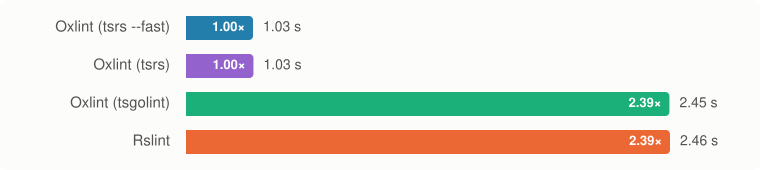
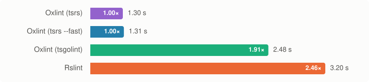
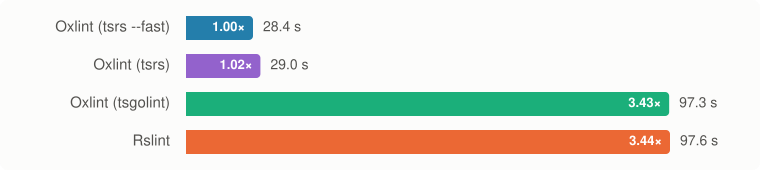
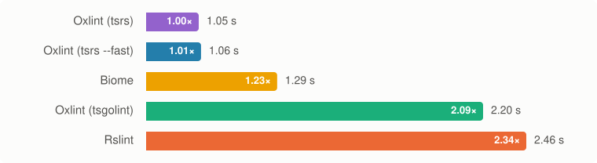
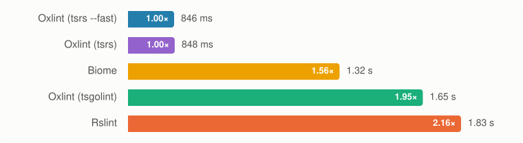
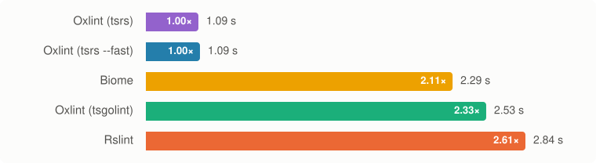
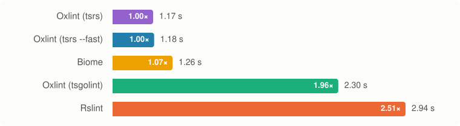

# Type-Aware Linter Benchmark

Rslint, Oxlint and Biome on seven Rstack monorepos, VS Code and TypeScript.

[Archived benchmark results](archives/README.md)

## Experiments

| Group | Tools | Rules |
|---|---|---|
| **A** | Rslint, Oxlint (tsgolint), Oxlint (tsrs), Oxlint (tsrs --fast) | 68 syntactic + 23 type-aware |
| **B** | Group A + Biome | 57 syntactic + 9 type-aware |
| **C** | Rslint, Oxlint, Biome | 56 syntactic, no type information |

Each group enables the shared rules from the pinned baseline. The type-aware Oxlint variants use one configuration, with different engines or presets. Oxlint (tsrs) sets `TSRS_FAST=0`; Oxlint (tsrs --fast) sets `TSRS_FAST=1`.

<!-- results:start -->
<!-- Generated by scripts/06-report.mjs. Do not edit by hand. -->

## Results

| Group | Fastest tool (fixtures won) |
|---|---|
| A | **Oxlint (tsrs)** 6/9 · **Oxlint (tsrs --fast)** 3/9 |
| B | **Oxlint (tsrs)** 5/9 · **Oxlint (tsrs --fast)** 4/9 |
| C | **Oxlint** 9/9 |

Runner: Linux 7.0.0-1017-azure (x64), AMD EPYC 9V74 80-Core Processor, 4 CPUs, 16 GiB RAM. Node v26.5.1, pnpm 12.18.0. [Workflow run](https://github.com/elecmonkey/linter-benchmark/actions/runs/44007236205).

The Oxlint variants use the same file scope and rule configuration. tsrs default mode uses `TSRS_FAST=0`; fast mode uses `TSRS_FAST=1`. Diagnostic counts can differ between engines and are reported separately.

### Group A: Rslint, Oxlint (tsgolint), Oxlint (tsrs), Oxlint (tsrs --fast)

68 syntactic + 23 type-aware rules. Median of 5 runs after 1 warmup. Bar lengths are log-scaled; the labels give exact values.

#### [rstack-cli](https://github.com/rstackjs/rstack-cli/tree/b35a79a98d4cdb84fc9c56f7b5fb5625cb74c1c9)

**Files:** 366


| Tool | Median | Min | Max | Peak RSS | Diagnostics | Relative |
|---|--:|--:|--:|--:|--:|--:|
| Oxlint (tsrs) | 498 ms | 480 ms | 525 ms | 247 MB | 259 | 1.00× |
| Oxlint (tsrs --fast) | 499 ms | 492 ms | 507 ms | 245 MB | 259 | 1.00× |
| Oxlint (tsgolint) | 1.00 s | 990 ms | 1.02 s | 488 MB | 259 | 2.01× |
| Rslint | 1.06 s | 1.05 s | 1.07 s | 307 MB | 468 | 2.14× |

#### [rspack](https://github.com/web-infra-dev/rspack/tree/6c1f72b0991a7c691c8e951d6a7821b3d532f6d5)

**Files:** 493


| Tool | Median | Min | Max | Peak RSS | Diagnostics | Relative |
|---|--:|--:|--:|--:|--:|--:|
| Oxlint (tsrs) | 647 ms | 633 ms | 654 ms | 310 MB | 3,178 | 1.00× |
| Oxlint (tsrs --fast) | 664 ms | 653 ms | 703 ms | 308 MB | 3,178 | 1.03× |
| Rslint | 1.35 s | 1.30 s | 1.44 s | 456 MB | 3,214 | 2.08× |
| Oxlint (tsgolint) | 1.40 s | 1.38 s | 1.41 s | 600 MB | 3,178 | 2.17× |

#### [rsdoctor](https://github.com/web-infra-dev/rsdoctor/tree/80b2381d1a20901e1f12b3f2bb2778aaacf94f2f)

**Files:** 734



| Tool | Median | Min | Max | Peak RSS | Diagnostics | Relative |
|---|--:|--:|--:|--:|--:|--:|
| Oxlint (tsrs --fast) | 1.03 s | 1.01 s | 1.04 s | 393 MB | 3,735 | 1.00× |
| Oxlint (tsrs) | 1.03 s | 1.02 s | 1.04 s | 395 MB | 3,735 | 1.00× |
| Oxlint (tsgolint) | 2.45 s | 2.44 s | 2.50 s | 917 MB | 3,735 | 2.39× |
| Rslint | 2.46 s | 2.39 s | 2.54 s | 635 MB | 3,708 | 2.39× |

#### [typescript6](https://github.com/microsoft/TypeScript/tree/050880ce59e30b356b686bd3144efe24f875ebc8)

**Files:** 745


| Tool | Median | Min | Max | Peak RSS | Diagnostics | Relative |
|---|--:|--:|--:|--:|--:|--:|
| Oxlint (tsrs) | 4.63 s | 4.60 s | 4.69 s | 567 MB | 11,416 | 1.00× |
| Rslint | 4.70 s | 4.65 s | 4.86 s | 688 MB | 11,724 | 1.02× |
| Oxlint (tsrs --fast) | 4.72 s | 4.66 s | 4.82 s | 563 MB | 11,416 | 1.02× |
| Oxlint (tsgolint) | 6.82 s | 6.79 s | 6.96 s | 1,236 MB | 11,416 | 1.47× |

#### [rspress](https://github.com/web-infra-dev/rspress/tree/6f87abf1d323ced2883261642561a3fc88fbd278)

**Files:** 746


| Tool | Median | Min | Max | Peak RSS | Diagnostics | Relative |
|---|--:|--:|--:|--:|--:|--:|
| Oxlint (tsrs) | 1.06 s | 1.04 s | 1.08 s | 349 MB | 2,741 | 1.00× |
| Oxlint (tsrs --fast) | 1.07 s | 1.07 s | 1.09 s | 356 MB | 2,741 | 1.01× |
| Oxlint (tsgolint) | 2.32 s | 2.29 s | 2.36 s | 823 MB | 2,741 | 2.18× |
| Rslint | 2.52 s | 2.41 s | 2.57 s | 537 MB | 2,875 | 2.38× |

#### [rslib](https://github.com/web-infra-dev/rslib/tree/0734e3624dd7bfb08fdfc4ff0416404a9a551df4)

**Files:** 1,018


| Tool | Median | Min | Max | Peak RSS | Diagnostics | Relative |
|---|--:|--:|--:|--:|--:|--:|
| Oxlint (tsrs --fast) | 852 ms | 840 ms | 873 ms | 345 MB | 674 | 1.00× |
| Oxlint (tsrs) | 859 ms | 841 ms | 863 ms | 362 MB | 674 | 1.01× |
| Oxlint (tsgolint) | 1.71 s | 1.66 s | 1.77 s | 688 MB | 675 | 2.01× |
| Rslint | 1.83 s | 1.79 s | 1.87 s | 527 MB | 661 | 2.15× |

#### [rstest](https://github.com/web-infra-dev/rstest/tree/03cabf3dd586392a6bfa4720e5a92c37281b943a)

**Files:** 2,139


| Tool | Median | Min | Max | Peak RSS | Diagnostics | Relative |
|---|--:|--:|--:|--:|--:|--:|
| Oxlint (tsrs) | 1.26 s | 1.25 s | 1.30 s | 424 MB | 35,913 | 1.00× |
| Oxlint (tsrs --fast) | 1.27 s | 1.22 s | 1.30 s | 423 MB | 35,913 | 1.00× |
| Oxlint (tsgolint) | 2.80 s | 2.77 s | 3.04 s | 868 MB | 35,913 | 2.22× |
| Rslint | 3.16 s | 3.11 s | 3.33 s | 536 MB | 36,572 | 2.50× |

#### [rsbuild](https://github.com/web-infra-dev/rsbuild/tree/622f5df2b43c12423b50ed986e0f0983c338bf91)

**Files:** 2,450



| Tool | Median | Min | Max | Peak RSS | Diagnostics | Relative |
|---|--:|--:|--:|--:|--:|--:|
| Oxlint (tsrs) | 1.30 s | 1.26 s | 1.31 s | 335 MB | 985 | 1.00× |
| Oxlint (tsrs --fast) | 1.31 s | 1.29 s | 1.35 s | 333 MB | 985 | 1.00× |
| Oxlint (tsgolint) | 2.48 s | 2.46 s | 2.60 s | 712 MB | 985 | 1.91× |
| Rslint | 3.20 s | 3.11 s | 3.41 s | 558 MB | 1,013 | 2.46× |

#### [vscode](https://github.com/microsoft/vscode/tree/f92b8f3adcd9bc034e6b9ade05c093dd59b99c5f)

**Files:** 14,258



| Tool | Median | Min | Max | Peak RSS | Diagnostics | Relative |
|---|--:|--:|--:|--:|--:|--:|
| Oxlint (tsrs --fast) | 20.9 s | 20.5 s | 21.3 s | 4,070 MB | 163,616 | 1.00× |
| Oxlint (tsrs) | 21.3 s | 20.8 s | 21.6 s | 4,610 MB | 163,616 | 1.02× |
| Rslint | 69.7 s | 66.7 s | 70.6 s | 14,261 MB | 167,372 | 3.33× |
| Oxlint (tsgolint) | 74.8 s | 70.2 s | 93.4 s | 14,453 MB | 163,615 | 3.57× |

### Group B: Rslint, Oxlint (tsgolint), Oxlint (tsrs), Oxlint (tsrs --fast), Biome

57 syntactic + 9 type-aware rules. Median of 5 runs after 1 warmup. Bar lengths are log-scaled; the labels give exact values.

#### [rstack-cli](https://github.com/rstackjs/rstack-cli/tree/b35a79a98d4cdb84fc9c56f7b5fb5625cb74c1c9)

**Files:** 366


| Tool | Median | Min | Max | Peak RSS | Diagnostics | Relative |
|---|--:|--:|--:|--:|--:|--:|
| Oxlint (tsrs --fast) | 490 ms | 475 ms | 493 ms | 236 MB | 36 | 1.00× |
| Oxlint (tsrs) | 494 ms | 492 ms | 513 ms | 249 MB | 36 | 1.01× |
| Biome | 564 ms | 552 ms | 576 ms | 284 MB | 22 | 1.15× |
| Oxlint (tsgolint) | 980 ms | 959 ms | 1.00 s | 481 MB | 36 | 2.00× |
| Rslint | 1.02 s | 1.00 s | 1.07 s | 322 MB | 25 | 2.08× |

#### [rspack](https://github.com/web-infra-dev/rspack/tree/6c1f72b0991a7c691c8e951d6a7821b3d532f6d5)

**Files:** 493


| Tool | Median | Min | Max | Peak RSS | Diagnostics | Relative |
|---|--:|--:|--:|--:|--:|--:|
| Oxlint (tsrs) | 596 ms | 586 ms | 610 ms | 300 MB | 998 | 1.00× |
| Oxlint (tsrs --fast) | 618 ms | 611 ms | 635 ms | 306 MB | 998 | 1.04× |
| Biome | 1.18 s | 1.16 s | 1.18 s | 493 MB | 937 | 1.97× |
| Rslint | 1.25 s | 1.20 s | 1.35 s | 402 MB | 1,021 | 2.09× |
| Oxlint (tsgolint) | 1.31 s | 1.26 s | 1.32 s | 645 MB | 998 | 2.19× |

#### [rsdoctor](https://github.com/web-infra-dev/rsdoctor/tree/80b2381d1a20901e1f12b3f2bb2778aaacf94f2f)

**Files:** 734


| Tool | Median | Min | Max | Peak RSS | Diagnostics | Relative |
|---|--:|--:|--:|--:|--:|--:|
| Oxlint (tsrs --fast) | 1.01 s | 978 ms | 1.05 s | 393 MB | 613 | 1.00× |
| Oxlint (tsrs) | 1.02 s | 983 ms | 1.07 s | 392 MB | 613 | 1.01× |
| Biome | 1.66 s | 1.60 s | 1.73 s | 687 MB | 549 | 1.65× |
| Oxlint (tsgolint) | 2.33 s | 2.27 s | 2.44 s | 831 MB | 613 | 2.32× |
| Rslint | 2.36 s | 2.29 s | 2.50 s | 641 MB | 625 | 2.34× |

#### [typescript6](https://github.com/microsoft/TypeScript/tree/050880ce59e30b356b686bd3144efe24f875ebc8)

**Files:** 745


| Tool | Median | Min | Max | Peak RSS | Diagnostics | Relative |
|---|--:|--:|--:|--:|--:|--:|
| Oxlint (tsrs) | 2.37 s | 2.32 s | 2.42 s | 549 MB | 1,885 | 1.00× |
| Oxlint (tsrs --fast) | 2.40 s | 2.36 s | 2.41 s | 559 MB | 1,885 | 1.01× |
| Rslint | 3.96 s | 3.95 s | 3.99 s | 720 MB | 2,213 | 1.67× |
| Oxlint (tsgolint) | 3.96 s | 3.91 s | 4.06 s | 1,184 MB | 1,885 | 1.67× |
| Biome | 13.4 s | 13.1 s | 13.6 s | 2,366 MB | 2,328 | 5.67× |

#### [rspress](https://github.com/web-infra-dev/rspress/tree/6f87abf1d323ced2883261642561a3fc88fbd278)

**Files:** 746



| Tool | Median | Min | Max | Peak RSS | Diagnostics | Relative |
|---|--:|--:|--:|--:|--:|--:|
| Oxlint (tsrs) | 1.05 s | 1.03 s | 1.06 s | 345 MB | 187 | 1.00× |
| Oxlint (tsrs --fast) | 1.06 s | 1.03 s | 1.07 s | 347 MB | 187 | 1.01× |
| Biome | 1.29 s | 1.27 s | 1.30 s | 559 MB | 179 | 1.23× |
| Oxlint (tsgolint) | 2.20 s | 2.17 s | 2.21 s | 762 MB | 187 | 2.09× |
| Rslint | 2.46 s | 2.41 s | 2.49 s | 547 MB | 190 | 2.34× |

#### [rslib](https://github.com/web-infra-dev/rslib/tree/0734e3624dd7bfb08fdfc4ff0416404a9a551df4)

**Files:** 1,018



| Tool | Median | Min | Max | Peak RSS | Diagnostics | Relative |
|---|--:|--:|--:|--:|--:|--:|
| Oxlint (tsrs --fast) | 846 ms | 824 ms | 857 ms | 338 MB | 207 | 1.00× |
| Oxlint (tsrs) | 848 ms | 821 ms | 855 ms | 341 MB | 207 | 1.00× |
| Biome | 1.32 s | 1.29 s | 1.37 s | 568 MB | 203 | 1.56× |
| Oxlint (tsgolint) | 1.65 s | 1.61 s | 1.69 s | 714 MB | 208 | 1.95× |
| Rslint | 1.83 s | 1.73 s | 1.84 s | 465 MB | 186 | 2.16× |

#### [rstest](https://github.com/web-infra-dev/rstest/tree/03cabf3dd586392a6bfa4720e5a92c37281b943a)

**Files:** 2,139



| Tool | Median | Min | Max | Peak RSS | Diagnostics | Relative |
|---|--:|--:|--:|--:|--:|--:|
| Oxlint (tsrs) | 1.09 s | 1.07 s | 1.11 s | 368 MB | 1,521 | 1.00× |
| Oxlint (tsrs --fast) | 1.09 s | 1.08 s | 1.12 s | 367 MB | 1,521 | 1.00× |
| Biome | 2.29 s | 2.25 s | 2.36 s | 749 MB | 1,576 | 2.11× |
| Oxlint (tsgolint) | 2.53 s | 2.47 s | 2.54 s | 838 MB | 1,521 | 2.33× |
| Rslint | 2.84 s | 2.76 s | 3.35 s | 513 MB | 1,578 | 2.61× |

#### [rsbuild](https://github.com/web-infra-dev/rsbuild/tree/622f5df2b43c12423b50ed986e0f0983c338bf91)

**Files:** 2,450



| Tool | Median | Min | Max | Peak RSS | Diagnostics | Relative |
|---|--:|--:|--:|--:|--:|--:|
| Oxlint (tsrs) | 1.17 s | 1.15 s | 1.21 s | 330 MB | 95 | 1.00× |
| Oxlint (tsrs --fast) | 1.18 s | 1.17 s | 1.21 s | 330 MB | 95 | 1.00× |
| Biome | 1.26 s | 1.25 s | 1.28 s | 283 MB | 153 | 1.07× |
| Oxlint (tsgolint) | 2.30 s | 2.23 s | 2.34 s | 685 MB | 95 | 1.96× |
| Rslint | 2.94 s | 2.82 s | 3.03 s | 551 MB | 82 | 2.51× |

#### [vscode](https://github.com/microsoft/vscode/tree/f92b8f3adcd9bc034e6b9ade05c093dd59b99c5f)

**Files:** 14,258


| Tool | Median | Min | Max | Peak RSS | Diagnostics | Relative |
|---|--:|--:|--:|--:|--:|--:|
| Oxlint (tsrs --fast) | 16.4 s | 16.2 s | 16.7 s | 3,748 MB | 50,346 | 1.00× |
| Oxlint (tsrs) | 16.6 s | 16.2 s | 16.9 s | 4,240 MB | 50,346 | 1.02× |
| Rslint | 54.6 s | 53.4 s | 55.8 s | 12,202 MB | 55,064 | 3.33× |
| Oxlint (tsgolint) | 56.4 s | 53.6 s | 58.2 s | 14,156 MB | 50,346 | 3.44× |
| Biome | 94.6 s | 92.7 s | 98.6 s | 14,291 MB | 43,975 | 5.78× |

### Group C: Rslint, Oxlint, Biome

56 syntactic rules, no type information. Median of 5 runs after 1 warmup. Bar lengths are log-scaled; the labels give exact values.

#### [rstack-cli](https://github.com/rstackjs/rstack-cli/tree/b35a79a98d4cdb84fc9c56f7b5fb5625cb74c1c9)

**Files:** 366


| Tool | Median | Min | Max | Peak RSS | Diagnostics | Relative |
|---|--:|--:|--:|--:|--:|--:|
| Oxlint | 64 ms | 53 ms | 65 ms | N/A | 0 | 1.00× |
| Biome | 135 ms | 132 ms | 141 ms | 88 MB | 13 | 2.12× |
| Rslint | 190 ms | 186 ms | 194 ms | 116 MB | 0 | 2.99× |

#### [rspack](https://github.com/web-infra-dev/rspack/tree/6c1f72b0991a7c691c8e951d6a7821b3d532f6d5)

**Files:** 493


| Tool | Median | Min | Max | Peak RSS | Diagnostics | Relative |
|---|--:|--:|--:|--:|--:|--:|
| Oxlint | 140 ms | 138 ms | 148 ms | 129 MB | 625 | 1.00× |
| Biome | 283 ms | 279 ms | 289 ms | 153 MB | 810 | 2.02× |
| Rslint | 314 ms | 304 ms | 320 ms | 161 MB | 624 | 2.25× |

#### [rsdoctor](https://github.com/web-infra-dev/rsdoctor/tree/80b2381d1a20901e1f12b3f2bb2778aaacf94f2f)

**Files:** 734


| Tool | Median | Min | Max | Peak RSS | Diagnostics | Relative |
|---|--:|--:|--:|--:|--:|--:|
| Oxlint | 77 ms | 74 ms | 79 ms | 103 MB | 297 | 1.00× |
| Biome | 266 ms | 265 ms | 267 ms | 136 MB | 357 | 3.48× |
| Rslint | 301 ms | 292 ms | 315 ms | 176 MB | 291 | 3.94× |

#### [typescript6](https://github.com/microsoft/TypeScript/tree/050880ce59e30b356b686bd3144efe24f875ebc8)

**Files:** 745


| Tool | Median | Min | Max | Peak RSS | Diagnostics | Relative |
|---|--:|--:|--:|--:|--:|--:|
| Oxlint | 374 ms | 367 ms | 408 ms | 253 MB | 1,526 | 1.00× |
| Rslint | 1.13 s | 1.10 s | 1.15 s | 442 MB | 1,530 | 3.02× |
| Biome | 7.45 s | 7.27 s | 7.54 s | 1,901 MB | 2,226 | 19.93× |

#### [rspress](https://github.com/web-infra-dev/rspress/tree/6f87abf1d323ced2883261642561a3fc88fbd278)

**Files:** 746


| Tool | Median | Min | Max | Peak RSS | Diagnostics | Relative |
|---|--:|--:|--:|--:|--:|--:|
| Oxlint | 73 ms | 70 ms | 79 ms | N/A | 50 | 1.00× |
| Biome | 252 ms | 249 ms | 255 ms | 129 MB | 92 | 3.45× |
| Rslint | 323 ms | 314 ms | 330 ms | 148 MB | 47 | 4.44× |

#### [rslib](https://github.com/web-infra-dev/rslib/tree/0734e3624dd7bfb08fdfc4ff0416404a9a551df4)

**Files:** 1,018


| Tool | Median | Min | Max | Peak RSS | Diagnostics | Relative |
|---|--:|--:|--:|--:|--:|--:|
| Oxlint | 72 ms | 71 ms | 77 ms | N/A | 67 | 1.00× |
| Biome | 231 ms | 227 ms | 236 ms | 111 MB | 98 | 3.20× |
| Rslint | 319 ms | 317 ms | 321 ms | 149 MB | 47 | 4.42× |

#### [rstest](https://github.com/web-infra-dev/rstest/tree/03cabf3dd586392a6bfa4720e5a92c37281b943a)

**Files:** 2,139


| Tool | Median | Min | Max | Peak RSS | Diagnostics | Relative |
|---|--:|--:|--:|--:|--:|--:|
| Oxlint | 119 ms | 117 ms | 122 ms | 123 MB | 757 | 1.00× |
| Biome | 626 ms | 620 ms | 636 ms | 230 MB | 1,208 | 5.25× |
| Rslint | 705 ms | 679 ms | 722 ms | 302 MB | 755 | 5.91× |

#### [rsbuild](https://github.com/web-infra-dev/rsbuild/tree/622f5df2b43c12423b50ed986e0f0983c338bf91)

**Files:** 2,450


| Tool | Median | Min | Max | Peak RSS | Diagnostics | Relative |
|---|--:|--:|--:|--:|--:|--:|
| Oxlint | 92 ms | 91 ms | 99 ms | 111 MB | 50 | 1.00× |
| Biome | 428 ms | 427 ms | 431 ms | 144 MB | 119 | 4.65× |
| Rslint | 564 ms | 559 ms | 568 ms | 224 MB | 45 | 6.13× |

#### [vscode](https://github.com/microsoft/vscode/tree/f92b8f3adcd9bc034e6b9ade05c093dd59b99c5f)

**Files:** 14,258


| Tool | Median | Min | Max | Peak RSS | Diagnostics | Relative |
|---|--:|--:|--:|--:|--:|--:|
| Oxlint | 1.44 s | 1.39 s | 1.53 s | 269 MB | 10,261 | 1.00× |
| Rslint | 12.6 s | 11.6 s | 12.8 s | 5,540 MB | 10,291 | 8.80× |
| Biome | 16.1 s | 15.7 s | 16.4 s | 5,968 MB | 18,604 | 11.24× |

<!-- results:end -->

## Methodology

The 92-rule baseline and equivalent Biome mappings are versioned in `rules/catalog.json`. Rule generation verifies Rslint support with and without a project, reads Oxlint's native rule inventory, and validates the Biome mappings against the pinned Biome version. Changing the baseline or Biome version requires reviewing the catalog explicitly. The resulting support matrix and A/B/C groups are generated into `rules/`.

Native rule namespaces are retained as required by the tools. The benchmark installs and runs only Rslint, Oxlint, its two type engines, and Biome.

Every tool scans the same JS/TS files outside `node_modules`, after repository ignore patterns and gitignored files are removed. Directory symlink aliases are excluded to avoid duplicate scans. Expected paths are stored in `scope/<fixture>.txt` and checked against each tool's output.

Type-aware rules run only on files covered by a TypeScript project. Rslint uses projectService and the type-aware Oxlint engines discover the nearest tsconfig. Biome uses its own inference. Group C disables type-aware rules and projectService; Oxlint runs without `--type-aware`. Diagnostic counts can differ between tools and modes.

Generated configurations replace the fixture's own lint configuration for the run. All selected rules use their default options at error severity. Oxlint's default categories and Biome's rule preset, formatter and assist are disabled.

Each combination receives one warmup and five measured runs. Multiple selected tools are interleaved. Wall time includes command launchers; peak RSS sums the whole process tree and is sampled every 50 ms. On macOS a persistent Python helper reads libproc; other platforms use `ps`. Sampler initialization is outside the timed command. The last run provides diagnostic counts by baseline rule ID. A 15-minute timeout kills the command's process group.

Commands that finish before a usable RSS sample retain their timing and diagnostic results; their RSS is `null` and displayed as `N/A`. This is a missing memory observation, not a failed lint run. An in-flight sample is awaited after the exit timestamp, so waiting for the sampler does not extend the measured wall time.

## Reproduce

Requires Node 26, pnpm 12, and Python 3 on macOS (standard library only).

```sh
pnpm install --frozen-lockfile
pnpm run setup
pnpm run rules && pnpm run scope && pnpm run configs
pnpm run bench -- --groups A,B,C --runs 5 --warmup 1
pnpm run chart && pnpm run report
```

`bench` accepts `--groups`, `--fixtures`, `--tools`, `--runs`, `--warmup` and `--timeout-min`. `chart` and `report` accept `--groups` and `--tools`. For a smoke run:

```sh
pnpm run bench -- --groups A --fixtures rstack-cli --runs 1 --warmup 0
```

| Tool ID | Display name | Groups |
|---|---|---|
| `rslint` | Rslint | A, B, C |
| `oxlint-tsgolint` | Oxlint (tsgolint) | A, B |
| `oxlint-tsrs` | Oxlint (tsrs) | A, B |
| `oxlint-tsrs-fast` | Oxlint (tsrs --fast) | A, B |
| `oxlint` | Oxlint | C |
| `biome` | Biome | B, C |

`report` regenerates the results section above. Do not edit that section by hand. See [AGENTS.md](AGENTS.md) for layout and resource requirements.

## Manual CI refresh

In GitHub Actions, select **Refresh benchmark results**, choose the `main` branch, and click **Run workflow**. The default runner is `ubuntu-24.04`; the `runner` input also accepts a larger runner label or a JSON label array such as `["self-hosted","linux","x64","benchmark"]`. A dedicated runner with at least 32 GiB RAM is recommended for the largest type-aware fixture; the standard public runner has about 16 GiB. Failed or incomplete measurements stop publication.

The workflow installs pinned dependencies and fixture revisions, regenerates the rule/configuration inputs, runs all tests, and benchmarks A/B/C with one warmup and five interleaved measurements. It clears the old measurement files first and validates all 108 fresh results before regenerating README and the 27 charts. Runner hardware and software information is included with the CI results so they can be distinguished from local measurements.

Results and logs are uploaded as artifacts. With `publish_results` enabled, the publishing job pushes only generated data to `ci/benchmark-results` on this repository and creates a PR to `main`, or updates the branch of its existing PR. It preserves branch history and uses no force push. A changed `main`, human edits to the automation branch/PR, or changes outside generated paths stop publication. With `publish_results` disabled, the workflow only saves artifacts.

A raw checkpoint is uploaded before validation, including exact result JSON and the generated inputs. The always-uploaded logs also contain a backup under `benchmark-checkpoint/`. Validation failures therefore preserve the measured data. Retrying only a failed publishing job can reuse the validated artifact from an earlier attempt of the same workflow run.

Before replacing live data, each results update PR snapshots the previous `main` revision into `archives/<full-source-commit>/`. It preserves the old README, results (raw JSON, charts, report and runner information), scope, configurations, rule metadata and version inputs. The archive keeps the repository-relative layout, so README images still resolve to its own `results/charts/` and the report uses its own `charts/`. Other relative Markdown/reference/HTML links are rewritten for the snapshot; links to uncopied source files point at the original commit. Existing snapshots are immutable and a repeated update from the same source commit verifies and reuses the snapshot. The archive index links to each historical README and report.

Enabling `publish_results` and submitting the manual dispatch approves the following fixed publication contract (`scripts/ci-contract.mjs`):

- Repository: `elecmonkey/linter-benchmark`
- Base: `main`
- Head: `ci/benchmark-results` in the same repository
- Commit message and PR title: `Update benchmark results`
- PR body:

```text
Refresh all A/B/C benchmark results, charts, scope, configurations, and README using the pinned fixture revisions and tool versions.

Each combination uses one warmup and five measured runs.
```

The workflow verifies the commit and PR text before publishing and reads them back afterward. The benchmark job has read-only repository permissions; only the publishing job receives `contents: write` and `pull-requests: write`. Enable **Allow GitHub Actions to create and approve pull requests** under the repository's Actions settings before using publication. The workflow creates PRs without approving or merging them.

## Versions

| Tool | Version |
|---|---|
| Rslint | `@rslint/core` 0.10.1 |
| Oxlint | 1.93.0 |
| tsgolint | `oxlint-tsgolint` 7.0.2007 |
| tsrs | 0.25.0-ts7.1.0-beta |
| Biome | 2.6.8 |
| Scope project loader | TypeScript 6.0.3 |
