# Type-Aware Linter Benchmark

ESLint vs Rslint vs Oxlint vs Biome on seven Rstack monorepos, VS Code and TypeScript.

## Experiments

| Group | Tools | Rules |
|---|---|---|
| **A** | ESLint (typescript-eslint), Rslint, Oxlint (oxlint-tsgolint) | 68 syntactic + **23 type-aware** |
| **B** | Group A + Biome | 57 syntactic + 9 type-aware |
| **C** | ESLint (typescript-eslint), Rslint, Oxlint, Biome, no type information | 56 syntactic |

Each group enables only the recommended rules that every tool in it implements equivalently.

<!-- results:start -->
<!-- Generated by scripts/06-report.mjs. Do not edit by hand. -->

## Results

| Group | Fastest tool (fixtures won) |
|---|---|
| A | **Rslint** 9/9 |
| B | **Rslint** 9/9 |
| C | **Oxlint** 9/9 |

### Group A: ESLint (typescript-eslint), Rslint, Oxlint (oxlint-tsgolint)

68 syntactic + 23 type-aware rules. Median of 5 runs after 1 warmup. Bar lengths are log-scaled; the labels give exact values.

#### [rstack-cli](https://github.com/rstackjs/rstack-cli/tree/b35a79a98d4cdb84fc9c56f7b5fb5625cb74c1c9)

**Files:** 366

| Tool | Median | Min | Max | Peak RSS | Diagnostics | Relative |
|---|--:|--:|--:|--:|--:|--:|
| Rslint | 378 ms | 354 ms | 398 ms | 367 MB | 468 | 1.00× |
| Oxlint (oxlint-tsgolint) | 583 ms | 553 ms | 603 ms | 464 MB | 259 | 1.54× |
| ESLint (typescript-eslint) | 11.5 s | 11.3 s | 11.5 s | 5,229 MB | 468 | 30.45× |

#### [rspack](https://github.com/web-infra-dev/rspack/tree/6c1f72b0991a7c691c8e951d6a7821b3d532f6d5)

**Files:** 499

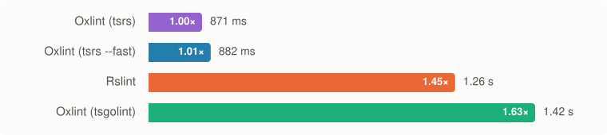

| Tool | Median | Min | Max | Peak RSS | Diagnostics | Relative |
|---|--:|--:|--:|--:|--:|--:|
| Rslint | 494 ms | 451 ms | 527 ms | 639 MB | 3,228 | 1.00× |
| Oxlint (oxlint-tsgolint) | 735 ms | 708 ms | 807 ms | 660 MB | 3,178 | 1.49× |
| ESLint (typescript-eslint) | 6.70 s | 6.64 s | 6.79 s | 2,302 MB | 3,231 | 13.54× |

#### [rsdoctor](https://github.com/web-infra-dev/rsdoctor/tree/80b2381d1a20901e1f12b3f2bb2778aaacf94f2f)

**Files:** 734

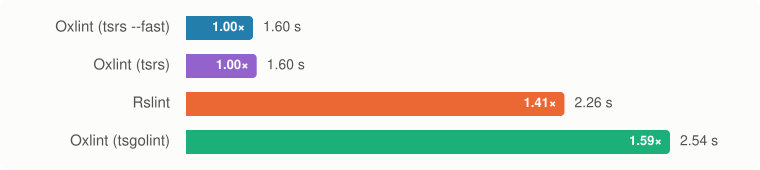

| Tool | Median | Min | Max | Peak RSS | Diagnostics | Relative |
|---|--:|--:|--:|--:|--:|--:|
| Rslint | 685 ms | 667 ms | 773 ms | 894 MB | 3,743 | 1.00× |
| Oxlint (oxlint-tsgolint) | 1.11 s | 1.06 s | 1.18 s | 770 MB | 3,738 | 1.62× |
| ESLint (typescript-eslint) | 13.7 s | 13.6 s | 13.7 s | 4,067 MB | 3,739 | 19.95× |

#### [typescript6](https://github.com/microsoft/TypeScript/tree/050880ce59e30b356b686bd3144efe24f875ebc8)

**Files:** 745

| Tool | Median | Min | Max | Peak RSS | Diagnostics | Relative |
|---|--:|--:|--:|--:|--:|--:|
| Rslint | 1.04 s | 1.00 s | 1.07 s | 1,324 MB | 11,741 | 1.00× |
| Oxlint (oxlint-tsgolint) | 3.81 s | 3.76 s | 3.86 s | 1,219 MB | 11,418 | 3.66× |
| ESLint (typescript-eslint) | 20.5 s | 20.1 s | 20.7 s | 4,648 MB | 11,862 | 19.71× |

#### [rspress](https://github.com/web-infra-dev/rspress/tree/6f87abf1d323ced2883261642561a3fc88fbd278)

**Files:** 746

| Tool | Median | Min | Max | Peak RSS | Diagnostics | Relative |
|---|--:|--:|--:|--:|--:|--:|
| Rslint | 648 ms | 612 ms | 705 ms | 708 MB | 2,880 | 1.00× |
| Oxlint (oxlint-tsgolint) | 1.19 s | 1.13 s | 1.29 s | 757 MB | 2,741 | 1.84× |
| ESLint (typescript-eslint) | 22.2 s | 21.9 s | 22.5 s | 8,316 MB | 2,888 | 34.28× |

#### [rslib](https://github.com/web-infra-dev/rslib/tree/0734e3624dd7bfb08fdfc4ff0416404a9a551df4)

**Files:** 1,018

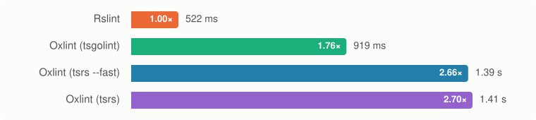

| Tool | Median | Min | Max | Peak RSS | Diagnostics | Relative |
|---|--:|--:|--:|--:|--:|--:|
| Rslint | 569 ms | 562 ms | 613 ms | 602 MB | 663 | 1.00× |
| Oxlint (oxlint-tsgolint) | 1.07 s | 1.04 s | 1.12 s | 680 MB | 685 | 1.88× |
| ESLint (typescript-eslint) | 21.0 s | 20.8 s | 21.8 s | 8,167 MB | 696 | 36.85× |

#### [rstest](https://github.com/web-infra-dev/rstest/tree/03cabf3dd586392a6bfa4720e5a92c37281b943a)

**Files:** 2,139

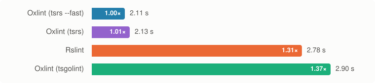

| Tool | Median | Min | Max | Peak RSS | Diagnostics | Relative |
|---|--:|--:|--:|--:|--:|--:|
| Rslint | 841 ms | 825 ms | 1.70 s | 880 MB | 36,597 | 1.00× |
| Oxlint (oxlint-tsgolint) | 1.37 s | 1.33 s | 1.52 s | 896 MB | 36,074 | 1.63× |
| ESLint (typescript-eslint) | 21.7 s | 21.2 s | 22.1 s | 6,810 MB | 36,604 | 25.81× |

#### [rsbuild](https://github.com/web-infra-dev/rsbuild/tree/622f5df2b43c12423b50ed986e0f0983c338bf91)

**Files:** 2,448

| Tool | Median | Min | Max | Peak RSS | Diagnostics | Relative |
|---|--:|--:|--:|--:|--:|--:|
| Rslint | 760 ms | 738 ms | 816 ms | 935 MB | 1,013 | 1.00× |
| Oxlint (oxlint-tsgolint) | 1.41 s | 1.35 s | 1.52 s | 712 MB | 985 | 1.85× |
| ESLint (typescript-eslint) | 27.7 s | 27.5 s | 28.5 s | 8,679 MB | 1,014 | 36.49× |

#### [vscode](https://github.com/microsoft/vscode/tree/f92b8f3adcd9bc034e6b9ade05c093dd59b99c5f)

**Files:** 14,260

| Tool | Median | Min | Max | Peak RSS | Diagnostics | Relative |
|---|--:|--:|--:|--:|--:|--:|
| Rslint | 14.5 s | 14.3 s | 14.8 s | 13,286 MB | 168,683 | 1.00× |
| Oxlint (oxlint-tsgolint) | 16.3 s | 15.9 s | 17.3 s | 14,579 MB | 163,428 | 1.13× |
| ESLint (typescript-eslint) | 593.4 s | 524.0 s | 733.5 s | 23,916 MB | 169,795 | 41.03× |

### Group B: ESLint (typescript-eslint), Rslint, Oxlint (oxlint-tsgolint), Biome

57 syntactic + 9 type-aware rules. Median of 5 runs after 1 warmup. Bar lengths are log-scaled; the labels give exact values.

#### [rstack-cli](https://github.com/rstackjs/rstack-cli/tree/b35a79a98d4cdb84fc9c56f7b5fb5625cb74c1c9)

**Files:** 366

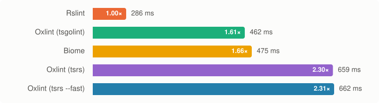

| Tool | Median | Min | Max | Peak RSS | Diagnostics | Relative |
|---|--:|--:|--:|--:|--:|--:|
| Rslint | 356 ms | 355 ms | 368 ms | 332 MB | 25 | 1.00× |
| Biome | 558 ms | 531 ms | 578 ms | 412 MB | 22 | 1.57× |
| Oxlint (oxlint-tsgolint) | 588 ms | 552 ms | 611 ms | 464 MB | 36 | 1.65× |
| ESLint (typescript-eslint) | 10.7 s | 10.6 s | 10.7 s | 5,176 MB | 25 | 29.97× |

#### [rspack](https://github.com/web-infra-dev/rspack/tree/6c1f72b0991a7c691c8e951d6a7821b3d532f6d5)

**Files:** 499

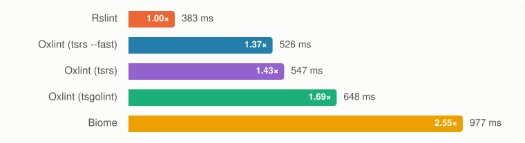

| Tool | Median | Min | Max | Peak RSS | Diagnostics | Relative |
|---|--:|--:|--:|--:|--:|--:|
| Rslint | 443 ms | 434 ms | 459 ms | 578 MB | 1,021 | 1.00× |
| Oxlint (oxlint-tsgolint) | 713 ms | 703 ms | 713 ms | 640 MB | 998 | 1.61× |
| Biome | 1.02 s | 990 ms | 1.08 s | 622 MB | 936 | 2.30× |
| ESLint (typescript-eslint) | 6.01 s | 5.98 s | 6.17 s | 2,235 MB | 1,023 | 13.59× |

#### [rsdoctor](https://github.com/web-infra-dev/rsdoctor/tree/80b2381d1a20901e1f12b3f2bb2778aaacf94f2f)

**Files:** 734

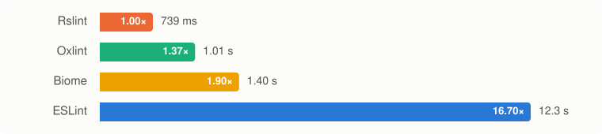

| Tool | Median | Min | Max | Peak RSS | Diagnostics | Relative |
|---|--:|--:|--:|--:|--:|--:|
| Rslint | 661 ms | 635 ms | 686 ms | 867 MB | 625 | 1.00× |
| Oxlint (oxlint-tsgolint) | 1.00 s | 982 ms | 1.03 s | 787 MB | 613 | 1.51× |
| Biome | 1.43 s | 1.37 s | 1.44 s | 865 MB | 562 | 2.16× |
| ESLint (typescript-eslint) | 12.4 s | 12.3 s | 12.4 s | 4,256 MB | 626 | 18.75× |

#### [typescript6](https://github.com/microsoft/TypeScript/tree/050880ce59e30b356b686bd3144efe24f875ebc8)

**Files:** 745

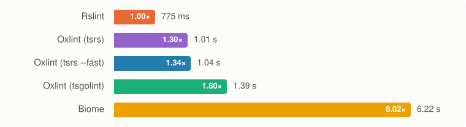

| Tool | Median | Min | Max | Peak RSS | Diagnostics | Relative |
|---|--:|--:|--:|--:|--:|--:|
| Rslint | 841 ms | 819 ms | 853 ms | 1,184 MB | 2,213 | 1.00× |
| Oxlint (oxlint-tsgolint) | 1.55 s | 1.49 s | 1.60 s | 1,114 MB | 1,885 | 1.84× |
| Biome | 6.10 s | 5.97 s | 6.29 s | 2,614 MB | 2,334 | 7.25× |
| ESLint (typescript-eslint) | 16.3 s | 16.0 s | 17.5 s | 4,479 MB | 2,331 | 19.36× |

#### [rspress](https://github.com/web-infra-dev/rspress/tree/6f87abf1d323ced2883261642561a3fc88fbd278)

**Files:** 746

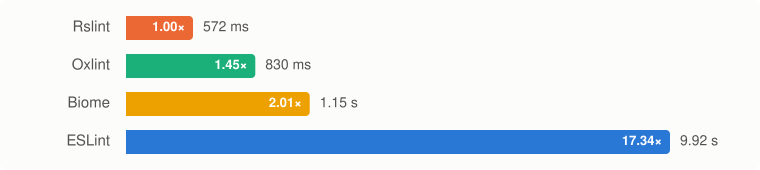

| Tool | Median | Min | Max | Peak RSS | Diagnostics | Relative |
|---|--:|--:|--:|--:|--:|--:|
| Rslint | 596 ms | 571 ms | 657 ms | 710 MB | 190 | 1.00× |
| Oxlint (oxlint-tsgolint) | 1.09 s | 1.05 s | 1.17 s | 727 MB | 187 | 1.82× |
| Biome | 1.21 s | 1.11 s | 1.24 s | 1,097 MB | 179 | 2.02× |
| ESLint (typescript-eslint) | 20.7 s | 20.7 s | 21.0 s | 7,966 MB | 198 | 34.79× |

#### [rslib](https://github.com/web-infra-dev/rslib/tree/0734e3624dd7bfb08fdfc4ff0416404a9a551df4)

**Files:** 1,018

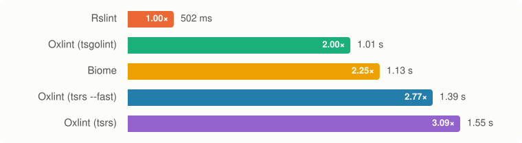

| Tool | Median | Min | Max | Peak RSS | Diagnostics | Relative |
|---|--:|--:|--:|--:|--:|--:|
| Rslint | 547 ms | 516 ms | 572 ms | 611 MB | 186 | 1.00× |
| Oxlint (oxlint-tsgolint) | 952 ms | 943 ms | 1.09 s | 755 MB | 214 | 1.74× |
| Biome | 1.17 s | 1.14 s | 1.22 s | 729 MB | 203 | 2.14× |
| ESLint (typescript-eslint) | 20.3 s | 20.1 s | 20.5 s | 8,116 MB | 213 | 37.10× |

#### [rstest](https://github.com/web-infra-dev/rstest/tree/03cabf3dd586392a6bfa4720e5a92c37281b943a)

**Files:** 2,139

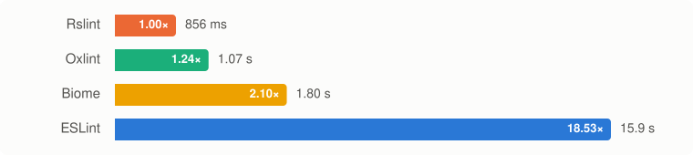

| Tool | Median | Min | Max | Peak RSS | Diagnostics | Relative |
|---|--:|--:|--:|--:|--:|--:|
| Rslint | 705 ms | 688 ms | 734 ms | 781 MB | 1,578 | 1.00× |
| Oxlint (oxlint-tsgolint) | 1.23 s | 1.15 s | 1.23 s | 853 MB | 1,535 | 1.74× |
| Biome | 1.79 s | 1.77 s | 1.89 s | 1,100 MB | 1,606 | 2.53× |
| ESLint (typescript-eslint) | 19.1 s | 18.9 s | 19.5 s | 6,668 MB | 1,585 | 27.05× |

#### [rsbuild](https://github.com/web-infra-dev/rsbuild/tree/622f5df2b43c12423b50ed986e0f0983c338bf91)

**Files:** 2,448

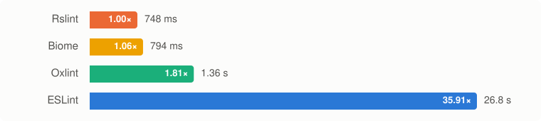

| Tool | Median | Min | Max | Peak RSS | Diagnostics | Relative |
|---|--:|--:|--:|--:|--:|--:|
| Rslint | 748 ms | 726 ms | 772 ms | 901 MB | 82 | 1.00× |
| Biome | 794 ms | 708 ms | 797 ms | 468 MB | 155 | 1.06× |
| Oxlint (oxlint-tsgolint) | 1.36 s | 1.33 s | 1.40 s | 711 MB | 95 | 1.81× |
| ESLint (typescript-eslint) | 26.8 s | 26.8 s | 27.0 s | 8,685 MB | 106 | 35.91× |

#### [vscode](https://github.com/microsoft/vscode/tree/f92b8f3adcd9bc034e6b9ade05c093dd59b99c5f)

**Files:** 14,260

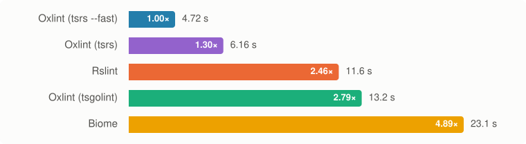

| Tool | Median | Min | Max | Peak RSS | Diagnostics | Relative |
|---|--:|--:|--:|--:|--:|--:|
| Rslint | 12.2 s | 11.9 s | 29.8 s | 11,426 MB | 55,064 | 1.00× |
| Oxlint (oxlint-tsgolint) | 13.5 s | 13.3 s | 14.0 s | 13,303 MB | 50,345 | 1.10× |
| Biome | 22.4 s | 21.6 s | 23.3 s | 17,841 MB | 43,921 | 1.83× |
| ESLint (typescript-eslint) | 487.6 s | 414.4 s | 499.6 s | 23,735 MB | 56,163 | 39.82× |

### Group C: ESLint (typescript-eslint), Rslint, Oxlint, Biome

56 syntactic rules, no type information. Median of 5 runs after 1 warmup. Bar lengths are log-scaled; the labels give exact values.

#### [rstack-cli](https://github.com/rstackjs/rstack-cli/tree/b35a79a98d4cdb84fc9c56f7b5fb5625cb74c1c9)

**Files:** 366

| Tool | Median | Min | Max | Peak RSS | Diagnostics | Relative |
|---|--:|--:|--:|--:|--:|--:|
| Oxlint | 85 ms | 76 ms | 90 ms | 48 MB | 0 | 1.00× |
| Biome | 164 ms | 163 ms | 167 ms | 92 MB | 13 | 1.92× |
| Rslint | 234 ms | 181 ms | 237 ms | 115 MB | 0 | 2.74× |
| ESLint (typescript-eslint) | 782 ms | 777 ms | 852 ms | 413 MB | 0 | 9.17× |

#### [rspack](https://github.com/web-infra-dev/rspack/tree/6c1f72b0991a7c691c8e951d6a7821b3d532f6d5)

**Files:** 499

| Tool | Median | Min | Max | Peak RSS | Diagnostics | Relative |
|---|--:|--:|--:|--:|--:|--:|
| Oxlint | 188 ms | 181 ms | 197 ms | 90 MB | 625 | 1.00× |
| Rslint | 242 ms | 234 ms | 291 ms | 157 MB | 624 | 1.29× |
| Biome | 244 ms | 235 ms | 248 ms | 166 MB | 809 | 1.30× |
| ESLint (typescript-eslint) | 1.45 s | 1.42 s | 1.49 s | 611 MB | 624 | 7.73× |

#### [rsdoctor](https://github.com/web-infra-dev/rsdoctor/tree/80b2381d1a20901e1f12b3f2bb2778aaacf94f2f)

**Files:** 734

| Tool | Median | Min | Max | Peak RSS | Diagnostics | Relative |
|---|--:|--:|--:|--:|--:|--:|
| Oxlint | 103 ms | 85 ms | 155 ms | 25 MB | 297 | 1.00× |
| Biome | 197 ms | 190 ms | 249 ms | 132 MB | 357 | 1.91× |
| Rslint | 217 ms | 209 ms | 300 ms | 122 MB | 291 | 2.10× |
| ESLint (typescript-eslint) | 1.48 s | 1.45 s | 1.51 s | 771 MB | 292 | 14.28× |

#### [typescript6](https://github.com/microsoft/TypeScript/tree/050880ce59e30b356b686bd3144efe24f875ebc8)

**Files:** 745

| Tool | Median | Min | Max | Peak RSS | Diagnostics | Relative |
|---|--:|--:|--:|--:|--:|--:|
| Oxlint | 356 ms | 297 ms | 371 ms | 338 MB | 1,526 | 1.00× |
| Rslint | 484 ms | 474 ms | 521 ms | 464 MB | 1,530 | 1.36× |
| Biome | 4.74 s | 4.66 s | 4.81 s | 1,958 MB | 2,226 | 13.32× |
| ESLint (typescript-eslint) | 5.67 s | 5.63 s | 6.01 s | 1,499 MB | 1,560 | 15.91× |

#### [rspress](https://github.com/web-infra-dev/rspress/tree/6f87abf1d323ced2883261642561a3fc88fbd278)

**Files:** 746

| Tool | Median | Min | Max | Peak RSS | Diagnostics | Relative |
|---|--:|--:|--:|--:|--:|--:|
| Oxlint | 85 ms | 79 ms | 156 ms | 63 MB | 50 | 1.00× |
| Biome | 247 ms | 243 ms | 289 ms | 122 MB | 92 | 2.91× |
| Rslint | 253 ms | 239 ms | 348 ms | 145 MB | 47 | 2.98× |
| ESLint (typescript-eslint) | 1.42 s | 1.38 s | 1.47 s | 689 MB | 53 | 16.67× |

#### [rslib](https://github.com/web-infra-dev/rslib/tree/0734e3624dd7bfb08fdfc4ff0416404a9a551df4)

**Files:** 1,018

| Tool | Median | Min | Max | Peak RSS | Diagnostics | Relative |
|---|--:|--:|--:|--:|--:|--:|
| Oxlint | 101 ms | 86 ms | 105 ms | 41 MB | 72 | 1.00× |
| Biome | 269 ms | 231 ms | 345 ms | 131 MB | 98 | 2.66× |
| Rslint | 290 ms | 280 ms | 373 ms | 143 MB | 47 | 2.87× |
| ESLint (typescript-eslint) | 1.08 s | 1.07 s | 1.10 s | 554 MB | 68 | 10.64× |

#### [rstest](https://github.com/web-infra-dev/rstest/tree/03cabf3dd586392a6bfa4720e5a92c37281b943a)

**Files:** 2,139

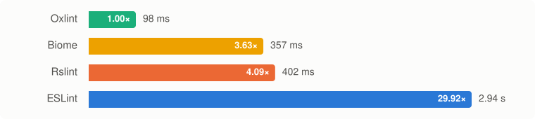

| Tool | Median | Min | Max | Peak RSS | Diagnostics | Relative |
|---|--:|--:|--:|--:|--:|--:|
| Oxlint | 98 ms | 97 ms | 179 ms | 80 MB | 757 | 1.00× |
| Biome | 357 ms | 312 ms | 403 ms | 225 MB | 1,208 | 3.63× |
| Rslint | 402 ms | 348 ms | 467 ms | 248 MB | 755 | 4.09× |
| ESLint (typescript-eslint) | 2.94 s | 2.91 s | 3.01 s | 719 MB | 755 | 29.92× |

#### [rsbuild](https://github.com/web-infra-dev/rsbuild/tree/622f5df2b43c12423b50ed986e0f0983c338bf91)

**Files:** 2,448

| Tool | Median | Min | Max | Peak RSS | Diagnostics | Relative |
|---|--:|--:|--:|--:|--:|--:|
| Oxlint | 137 ms | 103 ms | 180 ms | 83 MB | 50 | 1.00× |
| Rslint | 413 ms | 395 ms | 462 ms | 176 MB | 45 | 3.01× |
| Biome | 442 ms | 429 ms | 478 ms | 146 MB | 119 | 3.22× |
| ESLint (typescript-eslint) | 1.91 s | 1.91 s | 1.92 s | 631 MB | 50 | 13.90× |

#### [vscode](https://github.com/microsoft/vscode/tree/f92b8f3adcd9bc034e6b9ade05c093dd59b99c5f)

**Files:** 14,260

| Tool | Median | Min | Max | Peak RSS | Diagnostics | Relative |
|---|--:|--:|--:|--:|--:|--:|
| Oxlint | 494 ms | 423 ms | 521 ms | 435 MB | 10,260 | 1.00× |
| Rslint | 2.49 s | 2.30 s | 2.62 s | 5,915 MB | 10,291 | 5.04× |
| Biome | 4.38 s | 3.95 s | 4.47 s | 6,065 MB | 18,600 | 8.87× |
| ESLint (typescript-eslint) | 79.1 s | 75.6 s | 82.9 s | 2,248 MB | 11,344 | 160.06× |

<!-- results:end -->

## Fairness

Same files

Each fixture's scope is every JS/TS file the repository lints: the `.js/.jsx/.mjs/.cjs/.ts/.tsx/.mts/.cts` files on disk outside `node_modules`, minus the repository's global lint ignores (`rstack.config.*`, `eslint.config.*`, VS Code's `.eslint-ignore`) and minus gitignored files.

Type-aware rules run only on files that a tsconfig covers, found by projectService-style lookup. Every tool turns them off for the other files.

Each tool lints the fixture root, and its generated config selects the scope. After each run the files a tool linted are checked against `scope/<fixture>.txt`.

Same rules, default options

Every rule is set to `"error"` with its default options; the recommended presets pass no options. Nothing else is enabled: Oxlint's default `correctness` category and Biome's recommended preset are off, and Biome's formatter and assist are disabled.

Only Biome rules documented as "same as" the ESLint rule are used. "Inspired by" mappings are excluded. The full mapping is in `rules/matrix.json`, and the three rule sets are in `rules/groups.json`.

Group C is group B without its type-aware rules, and without `@typescript-eslint/no-unused-vars`: Rslint's implementation needs type information and skips the rule without it.

Same type information

ESLint and Rslint use `parserOptions.projectService: true`. Oxlint's `--type-aware` mode (tsgolint) finds the nearest tsconfig for each file, which is the same discovery.

Biome needs no tsconfig: it uses its own type inference rather than the TypeScript compiler, so its type-aware diagnostics differ from the other three.

Group C uses no type information: ESLint runs the typescript-eslint parser without `parserOptions`, Rslint has `projectService: false`, and Oxlint runs without `--type-aware`.

Repository lint configs are not used

The generated configs in `configs/` are copied into the fixture root for the duration of a run and passed with `-c`. Oxlint also runs with `--disable-nested-config`.

Measurement

- 1 warmup run, then 5 measured runs per tool, interleaved across tools so machine drift hits every tool equally.
- Wall time covers the whole command, Node launchers included.
- Peak RSS is the summed RSS of the whole process tree (launcher + native binary + tsgolint), sampled every 50 ms.
- Every tool runs with its default parallelism. ESLint's default is single-threaded.
- Output is machine-readable JSON written to a file. The last run's output is parsed into per-rule diagnostic counts as a check that the tools do comparable work.

Safety

Each run has a timeout (15 min by default) that kills its whole process group. ESLint runs with `--max-old-space-size=32768`, because typed linting exceeds Node's ~4 GB default heap on these monorepos, and 16 GB on VS Code.

## Reproduce

See [AGENTS.md](AGENTS.md).

## Versions

| Tool | Version |
|---|---|
| ESLint | 10.14.0 (`@eslint/js` 10.0.1) |
| typescript-eslint | 8.72.1, using TypeScript 6.0.3 |
| Rslint | `@rslint/core` 0.10.0 |
| Oxlint | 1.91.0, `oxlint-tsgolint` 7.0.2005 |
| Biome | 2.6.4 |
