# Results

| Group | Fastest tool (fixtures won) |
|---|---|
| A | **Rslint** 9/9 |
| B | **Rslint** 8/9 · **Biome** 1/9 |

## Group A: ESLint (typescript-eslint), Rslint, Oxlint (oxlint-tsgolint)

68 syntactic + 23 type-aware rules. Median of 5 runs after 1 warmup. Bar lengths are log-scaled; the labels give exact values.

### [rstack-cli](https://github.com/rstackjs/rstack-cli/tree/b35a79a98d4cdb84fc9c56f7b5fb5625cb74c1c9)

**Files:** 192

| Tool | Median | Min | Max | Peak RSS | Diagnostics | Relative |
|---|--:|--:|--:|--:|--:|--:|
| Rslint | 330 ms | 324 ms | 380 ms | 395 MB | 191 | 1.00× |
| Oxlint (oxlint-tsgolint) | 462 ms | 449 ms | 466 ms | 435 MB | 188 | 1.40× |
| ESLint (typescript-eslint) | 5.31 s | 5.12 s | 5.36 s | 2,155 MB | 191 | 16.12× |

### [vscode](https://github.com/microsoft/vscode/tree/f92b8f3adcd9bc034e6b9ade05c093dd59b99c5f)

**Files:** 312

| Tool | Median | Min | Max | Peak RSS | Diagnostics | Relative |
|---|--:|--:|--:|--:|--:|--:|
| Rslint | 352 ms | 339 ms | 359 ms | 427 MB | 996 | 1.00× |
| Oxlint (oxlint-tsgolint) | 523 ms | 489 ms | 644 ms | 478 MB | 953 | 1.49× |
| ESLint (typescript-eslint) | 4.69 s | 4.55 s | 4.72 s | 1,560 MB | 1,010 | 13.33× |

### [rspack](https://github.com/web-infra-dev/rspack/tree/6c1f72b0991a7c691c8e951d6a7821b3d532f6d5)

**Files:** 352

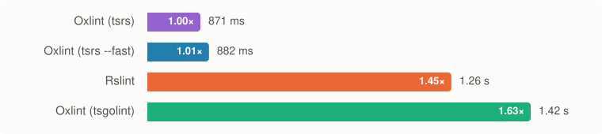

| Tool | Median | Min | Max | Peak RSS | Diagnostics | Relative |
|---|--:|--:|--:|--:|--:|--:|
| Rslint | 370 ms | 359 ms | 421 ms | 430 MB | 2,196 | 1.00× |
| Oxlint (oxlint-tsgolint) | 524 ms | 465 ms | 576 ms | 448 MB | 2,167 | 1.41× |
| ESLint (typescript-eslint) | 4.69 s | 4.67 s | 4.79 s | 1,548 MB | 2,196 | 12.67× |

### [rspress](https://github.com/web-infra-dev/rspress/tree/6f87abf1d323ced2883261642561a3fc88fbd278)

**Files:** 466

| Tool | Median | Min | Max | Peak RSS | Diagnostics | Relative |
|---|--:|--:|--:|--:|--:|--:|
| Rslint | 616 ms | 573 ms | 634 ms | 687 MB | 995 | 1.00× |
| Oxlint (oxlint-tsgolint) | 891 ms | 847 ms | 908 ms | 656 MB | 980 | 1.45× |
| ESLint (typescript-eslint) | 10.6 s | 10.5 s | 10.7 s | 3,097 MB | 1,001 | 17.22× |

### [rslib](https://github.com/web-infra-dev/rslib/tree/0734e3624dd7bfb08fdfc4ff0416404a9a551df4)

**Files:** 501

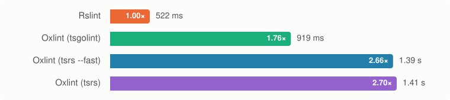

| Tool | Median | Min | Max | Peak RSS | Diagnostics | Relative |
|---|--:|--:|--:|--:|--:|--:|
| Rslint | 605 ms | 578 ms | 649 ms | 524 MB | 567 | 1.00× |
| Oxlint (oxlint-tsgolint) | 739 ms | 690 ms | 786 ms | 592 MB | 558 | 1.22× |
| ESLint (typescript-eslint) | 14.8 s | 14.7 s | 15.0 s | 6,155 MB | 567 | 24.47× |

### [typescript6](https://github.com/microsoft/TypeScript/tree/050880ce59e30b356b686bd3144efe24f875ebc8)

**Files:** 601

| Tool | Median | Min | Max | Peak RSS | Diagnostics | Relative |
|---|--:|--:|--:|--:|--:|--:|
| Rslint | 1.04 s | 1.03 s | 1.09 s | 1,026 MB | 11,109 | 1.00× |
| Oxlint (oxlint-tsgolint) | 3.56 s | 3.55 s | 3.62 s | 1,101 MB | 10,785 | 3.42× |
| ESLint (typescript-eslint) | 18.8 s | 18.8 s | 19.1 s | 4,430 MB | 11,139 | 18.07× |

### [rsdoctor](https://github.com/web-infra-dev/rsdoctor/tree/80b2381d1a20901e1f12b3f2bb2778aaacf94f2f)

**Files:** 646

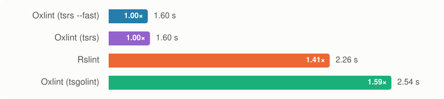

| Tool | Median | Min | Max | Peak RSS | Diagnostics | Relative |
|---|--:|--:|--:|--:|--:|--:|
| Rslint | 774 ms | 730 ms | 846 ms | 828 MB | 3,652 | 1.00× |
| Oxlint (oxlint-tsgolint) | 1.06 s | 1.03 s | 1.28 s | 753 MB | 3,647 | 1.36× |
| ESLint (typescript-eslint) | 13.2 s | 13.1 s | 13.8 s | 4,177 MB | 3,659 | 17.07× |

### [rsbuild](https://github.com/web-infra-dev/rsbuild/tree/622f5df2b43c12423b50ed986e0f0983c338bf91)

**Files:** 1,249

| Tool | Median | Min | Max | Peak RSS | Diagnostics | Relative |
|---|--:|--:|--:|--:|--:|--:|
| Rslint | 906 ms | 855 ms | 1.04 s | 869 MB | 924 | 1.00× |
| Oxlint (oxlint-tsgolint) | 1.22 s | 1.14 s | 1.29 s | 680 MB | 922 | 1.34× |
| ESLint (typescript-eslint) | 22.6 s | 22.2 s | 24.8 s | 7,197 MB | 939 | 24.99× |

### [rstest](https://github.com/web-infra-dev/rstest/tree/03cabf3dd586392a6bfa4720e5a92c37281b943a)

**Files:** 1,688

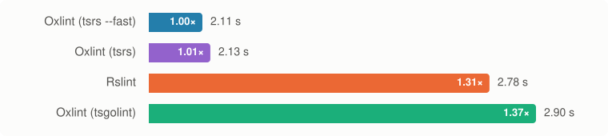

| Tool | Median | Min | Max | Peak RSS | Diagnostics | Relative |
|---|--:|--:|--:|--:|--:|--:|
| Rslint | 937 ms | 891 ms | 1.02 s | 1,007 MB | 35,895 | 1.00× |
| Oxlint (oxlint-tsgolint) | 1.18 s | 1.12 s | 1.26 s | 823 MB | 35,797 | 1.26× |
| ESLint (typescript-eslint) | 17.2 s | 17.2 s | 17.6 s | 5,369 MB | 35,896 | 18.39× |

## Group B: ESLint (typescript-eslint), Rslint, Oxlint (oxlint-tsgolint), Biome

57 syntactic + 9 type-aware rules. Median of 5 runs after 1 warmup. Bar lengths are log-scaled; the labels give exact values.

### [rstack-cli](https://github.com/rstackjs/rstack-cli/tree/b35a79a98d4cdb84fc9c56f7b5fb5625cb74c1c9)

**Files:** 192

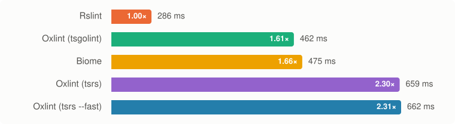

| Tool | Median | Min | Max | Peak RSS | Diagnostics | Relative |
|---|--:|--:|--:|--:|--:|--:|
| Rslint | 375 ms | 326 ms | 379 ms | 388 MB | 7 | 1.00× |
| Oxlint (oxlint-tsgolint) | 455 ms | 449 ms | 459 ms | 449 MB | 4 | 1.21× |
| Biome | 577 ms | 546 ms | 579 ms | 462 MB | 12 | 1.54× |
| ESLint (typescript-eslint) | 4.99 s | 4.95 s | 5.00 s | 2,140 MB | 7 | 13.29× |

### [vscode](https://github.com/microsoft/vscode/tree/f92b8f3adcd9bc034e6b9ade05c093dd59b99c5f)

**Files:** 312

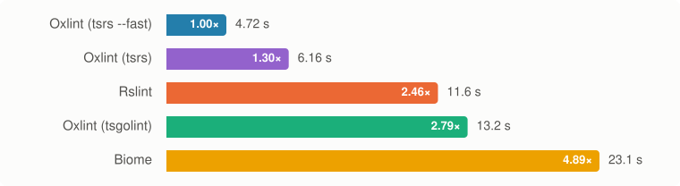

| Tool | Median | Min | Max | Peak RSS | Diagnostics | Relative |
|---|--:|--:|--:|--:|--:|--:|
| Rslint | 336 ms | 330 ms | 390 ms | 409 MB | 520 | 1.00× |
| Oxlint (oxlint-tsgolint) | 492 ms | 489 ms | 562 ms | 473 MB | 477 | 1.46× |
| ESLint (typescript-eslint) | 4.18 s | 4.13 s | 4.40 s | 1,517 MB | 534 | 12.41× |
| Biome | 4.51 s | 4.11 s | 4.59 s | 6,949 MB | 452 | 13.42× |

### [rspack](https://github.com/web-infra-dev/rspack/tree/6c1f72b0991a7c691c8e951d6a7821b3d532f6d5)

**Files:** 352

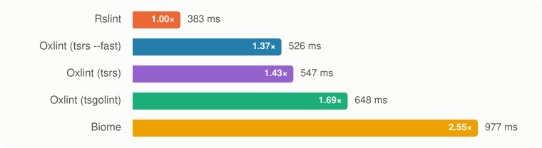

| Tool | Median | Min | Max | Peak RSS | Diagnostics | Relative |
|---|--:|--:|--:|--:|--:|--:|
| Rslint | 342 ms | 335 ms | 357 ms | 418 MB | 784 | 1.00× |
| Oxlint (oxlint-tsgolint) | 452 ms | 445 ms | 549 ms | 436 MB | 764 | 1.32× |
| ESLint (typescript-eslint) | 4.35 s | 4.17 s | 4.37 s | 1,498 MB | 784 | 12.70× |
| Biome | crashed | | | | | |

Biome crashed on every run and produced no lint output: internal error `` The parser is no longer progressing. Stuck at '(' L_PAREN:21069..21070 ``.

### [rspress](https://github.com/web-infra-dev/rspress/tree/6f87abf1d323ced2883261642561a3fc88fbd278)

**Files:** 466

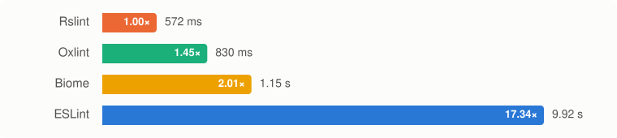

| Tool | Median | Min | Max | Peak RSS | Diagnostics | Relative |
|---|--:|--:|--:|--:|--:|--:|
| Rslint | 572 ms | 554 ms | 650 ms | 663 MB | 149 | 1.00× |
| Oxlint (oxlint-tsgolint) | 830 ms | 790 ms | 874 ms | 691 MB | 148 | 1.45× |
| Biome | 1.15 s | 1.12 s | 1.19 s | 977 MB | 150 | 2.01× |
| ESLint (typescript-eslint) | 9.92 s | 9.80 s | 10.0 s | 3,057 MB | 155 | 17.34× |

### [rslib](https://github.com/web-infra-dev/rslib/tree/0734e3624dd7bfb08fdfc4ff0416404a9a551df4)

**Files:** 501

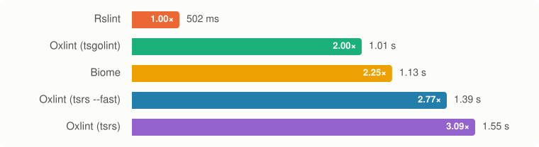

| Tool | Median | Min | Max | Peak RSS | Diagnostics | Relative |
|---|--:|--:|--:|--:|--:|--:|
| Rslint | 611 ms | 588 ms | 654 ms | 524 MB | 162 | 1.00× |
| Oxlint (oxlint-tsgolint) | 685 ms | 681 ms | 734 ms | 576 MB | 154 | 1.12× |
| Biome | 1.06 s | 1.05 s | 1.14 s | 650 MB | 143 | 1.74× |
| ESLint (typescript-eslint) | 14.3 s | 14.2 s | 14.5 s | 6,074 MB | 162 | 23.48× |

### [typescript6](https://github.com/microsoft/TypeScript/tree/050880ce59e30b356b686bd3144efe24f875ebc8)

**Files:** 601

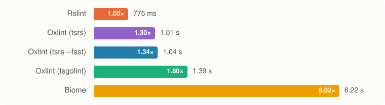

| Tool | Median | Min | Max | Peak RSS | Diagnostics | Relative |
|---|--:|--:|--:|--:|--:|--:|
| Rslint | 811 ms | 801 ms | 1.04 s | 950 MB | 1,678 | 1.00× |
| Oxlint (oxlint-tsgolint) | 1.27 s | 1.24 s | 1.32 s | 937 MB | 1,361 | 1.56× |
| ESLint (typescript-eslint) | 14.9 s | 14.7 s | 15.0 s | 4,118 MB | 1,709 | 18.38× |
| Biome | crashed | | | | | |

Biome crashed on every run and produced no lint output: internal error `` assertion `left == right` failed: expected L_PAREN but at SEMICOLON -- text: ";" at 115..116 ``.

### [rsdoctor](https://github.com/web-infra-dev/rsdoctor/tree/80b2381d1a20901e1f12b3f2bb2778aaacf94f2f)

**Files:** 646

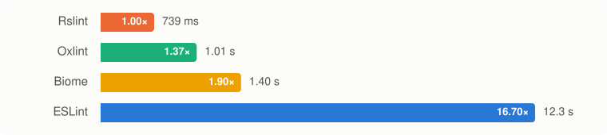

| Tool | Median | Min | Max | Peak RSS | Diagnostics | Relative |
|---|--:|--:|--:|--:|--:|--:|
| Rslint | 739 ms | 686 ms | 993 ms | 863 MB | 595 | 1.00× |
| Oxlint (oxlint-tsgolint) | 1.01 s | 1.00 s | 1.14 s | 776 MB | 583 | 1.37× |
| Biome | 1.40 s | 1.40 s | 1.42 s | 836 MB | 523 | 1.90× |
| ESLint (typescript-eslint) | 12.3 s | 12.2 s | 12.5 s | 4,106 MB | 597 | 16.70× |

### [rsbuild](https://github.com/web-infra-dev/rsbuild/tree/622f5df2b43c12423b50ed986e0f0983c338bf91)

**Files:** 1,249

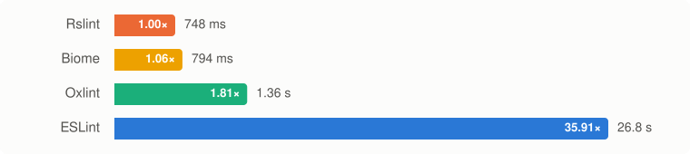

| Tool | Median | Min | Max | Peak RSS | Diagnostics | Relative |
|---|--:|--:|--:|--:|--:|--:|
| Biome | 526 ms | 500 ms | 557 ms | 214 MB | 126 | 1.00× |
| Rslint | 879 ms | 843 ms | 942 ms | 843 MB | 56 | 1.67× |
| Oxlint (oxlint-tsgolint) | 1.18 s | 1.15 s | 1.19 s | 679 MB | 50 | 2.24× |
| ESLint (typescript-eslint) | 21.2 s | 21.2 s | 21.4 s | 7,195 MB | 67 | 40.32× |

### [rstest](https://github.com/web-infra-dev/rstest/tree/03cabf3dd586392a6bfa4720e5a92c37281b943a)

**Files:** 1,688

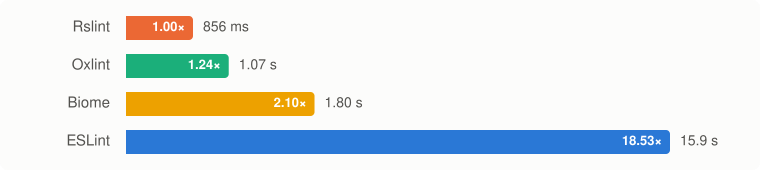

| Tool | Median | Min | Max | Peak RSS | Diagnostics | Relative |
|---|--:|--:|--:|--:|--:|--:|
| Rslint | 856 ms | 787 ms | 936 ms | 857 MB | 1,459 | 1.00× |
| Oxlint (oxlint-tsgolint) | 1.07 s | 1.04 s | 1.17 s | 753 MB | 1,404 | 1.24× |
| Biome | 1.80 s | 1.73 s | 1.83 s | 1,046 MB | 1,483 | 2.10× |
| ESLint (typescript-eslint) | 15.9 s | 15.5 s | 16.1 s | 4,913 MB | 1,460 | 18.53× |
